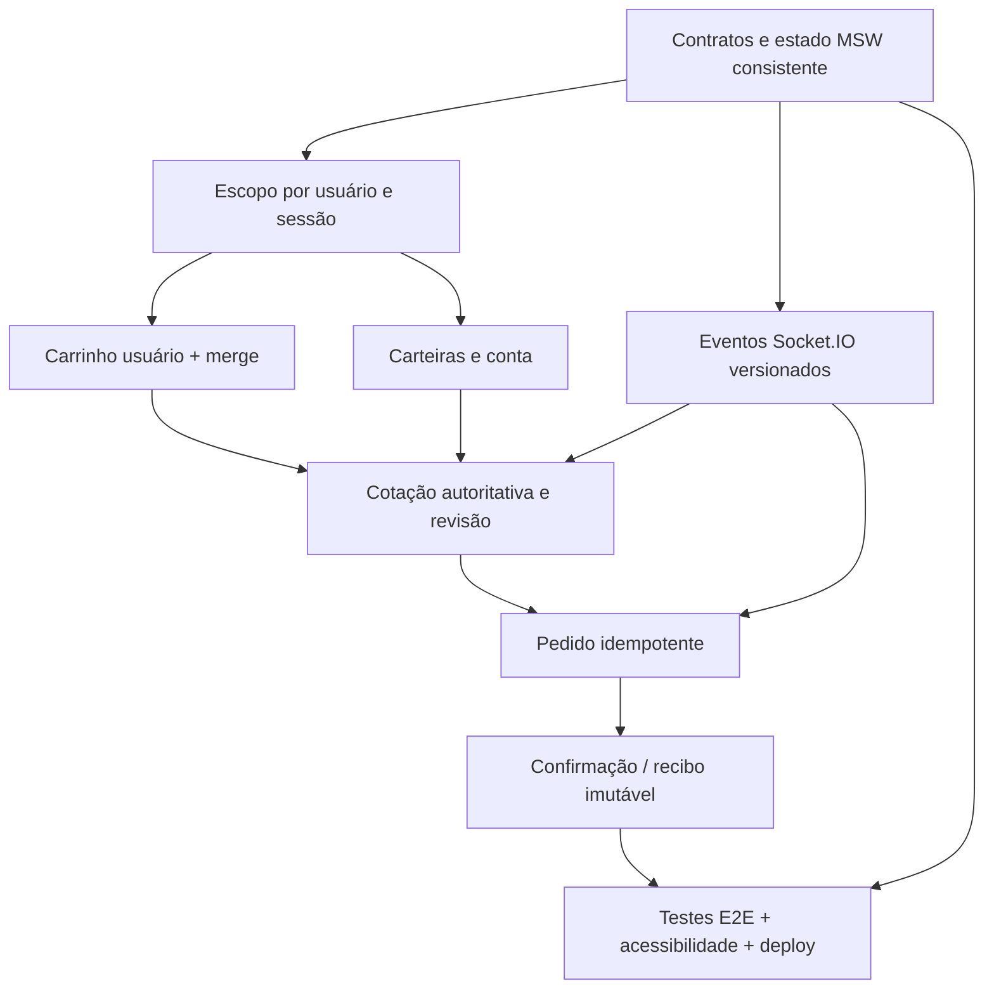

# NFT Marketplace — Próximos passos de desenvolvimento

> **Atualizado:** 05/11/2026<br>
> **Base:** `TASKS.md` compartilhado pelo candidato e README oficial do desafio.<br>
> **Objetivo:** concluir os fluxos essenciais da aplicação sem reimplementar as telas e a autenticação já existentes.<br>
> **Legenda:** `[x]` concluído *conforme evidência relatada*; `[ ]` não concluído ou ainda não comprovado.

## 0. Estado atual

| Área | O que o TASKS.md registra | O que falta comprovar/implementar |
|---|---|---|
| Fundação | Stack inicial, contratos compartilhados parciais, reset e cenários MSW | Contratos de pedidos, cenários restantes, reset integral, deploy e socket robusto |
| Catálogo | Home, filtros/URL, ordenação, paginação e detalhe, com mobile | Respostas fora de ordem, erros/retries, galeria completa e cobertura E2E restante |
| Autenticação | Login, cadastro, logout, sessão e proteção inicial do checkout | Expiração em tela aberta, isolamento total A→B, limpeza de Query/socket, autorização de pedidos |
| Conta | Perfil, favoritos e cadastro/edição de carteiras persistem por usuário | E-mail editável, seleção de carteira no checkout e isolamento dos recursos restantes |
| Carrinho | Carrinho visitante em IndexedDB, itens, quantidades, cupons e cotação via MSW | Carrinho por usuário, merge transacional, alterações em tempo real, proteção contra cotações obsoletas |
| Checkout | Interface desktop/mobile, resumo e cotação | Carteira/rede, validação e confirmação real, pedido idempotente e reconciliação |
| Pedidos | Prévia demonstrativa independente | Pedido real simulado pendente/confirmado/recusado, recibo snapshot e recuperação |
| Qualidade | Vários testes direcionados, build/typecheck e inspeções visuais | Cobertura E2E exigida, baselines, relatório Lighthouse, deploy e documentação final |

**Última evidência registrada:** a suíte completa no preview passou com 64 testes após a implementação de carteiras. Depois da alteração da sidebar e do cabeçalho, typecheck, build, verificação de tokens e 17 testes direcionados no preview passaram; capturas em 1440 e 390 px foram inspecionadas. Esses resultados são históricos e não foram reexecutados nesta atualização documental.

**Não tratar como concluído** um item simplesmente porque a tela existe.

## 1. Regras que nunca podem ser quebradas

1. Manter uso efetivo de **React, TypeScript, TanStack Router, TanStack Query, Axios, REST, Socket.IO, Tailwind, shadcn/ui, MSW, Playwright e Lighthouse**.
2. Componentes não acessam fixtures diretamente; REST via Axios e eventos por `socket.io-client` usando mecanismo MSW compatível.
3. Nenhuma compra é confirmada só por estado visual. O pedido deve existir na API simulada e estar **confirmado**.
4. Dados de usuários distintos (sessão, perfil, favoritos, carteiras, carrinho, pedidos e cache) não podem vazar entre contas.
5. Valores ETH trafegam como **strings decimais** e são operados por biblioteca de precisão decimal.
6. Reconexão ou timeout não pode criar pedidos duplicados; pedidos têm chave de idempotência.
7. O build publicado precisa funcionar com mocks, acesso direto às rotas e refresh.
8. Manter funcionalidades não implementadas indisponíveis — nunca simular sucesso.

## 2. Dependências técnicas



## 3. Backlog na ordem de execução

### BLOCO A — Fundação mínima pendente (P0)

**A1. Contratos e query keys compartilhadas (`M0-02`).**
- [x] Exportar schemas/tipos existentes de `User`, `Session`, `NFT`, `Edition`, `CatalogFilters`, `Cart`, `CartItem` e `Quote`.
- [x] Criar schemas propostos de `Wallet`, `Order` e snapshot de cotação; validar exemplos válidos e inválidos em teste isolado.
- [x] Integrar o contrato de carteiras ao transporte, aos handlers e à interface de cadastro/edição.
- [ ] Definir e integrar contratos finais de pedido e `OrderReceipt` real; a prévia usa seu DTO existente.
- [x] Declarar os códigos gerais de erro e um schema compatível com os códigos específicos existentes.
- [ ] Normalizar e aplicar os códigos gerais nas fronteiras sem quebrar os códigos públicos existentes.
- [x] Centralizar as query keys existentes e documentar a política atual de invalidação e retry; a chave de perfil inclui `userId`.
- [ ] Completar o escopo privado de todas as queries conforme os recursos forem implementados; carrinho e cotação atuais continuam de visitante.
- [x] Preservar os contratos públicos existentes nas alterações realizadas; compatibilização futura continua documentada.

**Aceite:** rotas, camada de transporte e mocks importam os mesmos contratos; `typecheck` e build passam.

**A2. Repositório simulado persistente e cenários (`M0-05`).**
- [x] Disponibilizar duas contas fictícias e validar persistência e isolamento de perfil entre elas.
- [x] Disponibilizar cenários reproduzíveis para catálogo padrão/vazio, 404/500, falha de rede, latência, preço alterado e estoque esgotado.
- [x] Compartilhar os valores simulados de preço e estoque entre listagem, detalhe, carrinho e cotação; testar consistência REST e rejeição de inclusão sem estoque.
- [x] Resetar cenário, sessões, cadastros, perfis, favoritos, carteiras e carrinho visitante existentes, com testes de restauração após refresh.
- [ ] Completar os demais cenários necessários e validar seus efeitos na interface e por Socket.IO quando aplicável.
- [ ] Implementar reset integral que inclua pedidos e carrinhos por usuário quando seus repositórios existirem; resolver a limpeza de token/cache e a atomicidade entre bases.
- [ ] Garantir consistência e isolamento de todos os recursos e mutations ainda não implementados.

**Aceite:** reset garante mesmas fixtures; refresh mantém estado, troca de usuário isola dados.

**Evidência e limites — 05/11/2026:** contratos existentes e chaves compartilhadas foram inspecionados; `typecheck` e build passaram. No preview, 7 testes de fundação, perfil e smoke passaram, incluindo persistência/reset e isolamento de perfil entre Ana e Bruno. Carrinho continua de visitante; não foi comprovado isolamento de carrinho por usuário.

- `POST /api/__test/scenario` aceita `{ "catalog": "default" | "empty" | "http-404" | "http-500" | "network-error" | "slow" | "price-changed" | "out-of-stock" }`. A seleção persiste no navegador até `POST /api/__test/reset`; latência é de 1200 ms. Erros e lentidão afetam somente `GET /api/nfts`. Preço/estoque alteram `nft-1` e são compartilhados por listagem, detalhe e carrinho/cotação.
- Reset limpa cenário, sessões, contas cadastradas, perfis, favoritos, carteiras e carrinho visitante; as bases são limpas sequencialmente e token/cache da página aberta não são apagados. Pedidos ainda não possuem repositório e não podem ser considerados cobertos.
- No preview, a suíte completa passou com 57 testes antes da adição dos schemas propostos; depois, o teste isolado dos schemas também passou. Os 5 testes direcionados incluem erros 404/500/rede, latência, resultado vazio, persistência, reset e consistência de preço/estoque entre REST de catálogo/detalhe/carrinho/cotação. Não se comprovou aviso na UI, invalidação de cotação nem evento Socket.IO para essas alterações.
- O contrato de carteira está integrado aos endpoints e à interface de conta. Os schemas propostos de snapshot e pedido não estão integrados a endpoints nem validam todas as regras de negócio.
- Permanecem abertos: contratos finais e fronteiras de pedido/recibo real, normalização efetiva dos erros, cenários adicionais e isolamento de recursos privados ainda não implementados. Compatibilização proposta: manter os contratos e códigos atuais e introduzir adaptadores/versionamento antes de qualquer mudança pública.

**A3. Deploy de verificação (`M0-06`, em paralelo).** Publicação e validação pública aguardam autorização explícita do usuário.
- [ ] Publicar a versão atual sem esperar pelo checkout.
- [ ] Confirmar service worker do MSW e conexão Socket.IO no build publicado.
- [ ] Confirmar acesso direto, refresh e 404 para URLs profundas.

### BLOCO B — Sessão, isolamento e carrinho (P0)

**B1. Escopo e encerramento de sessão (`M2-01/02`).**
- [ ] Interceptar expiração de sessão em tela aberta, não apenas após refresh.
- [ ] Cancelar/limpar queries privadas no logout e na troca de usuário.
- [ ] Encerrar listeners e subscriptions do usuário anterior.
- [ ] Garantir que usuário B não consulta perfil, carteiras, carrinho, favoritos nem pedido de A, inclusive por URL direta.
- [x] Preservar rota local de retorno após login e rejeitar redirect externo; comportamento validado nos testes de autenticação.

**Aceite:** teste A→logout→B sem dados residuais e requisição de pedido alheio retorna `403` ou `404` consistente.

**B2. Carrinho de conta e merge (`M3-01/02`).**
- [ ] Implementar armazenamento de carrinho por usuário, mantendo carrinho visitante separado.
- [ ] No login/cadastro, mesclar carrinho convidado uma única vez, com política documentada para itens coincidentes, estoque insuficiente e edições indisponíveis.
- [x] Atualizar quantidades, remoção e cupons do carrinho visitante via API simulada.
- [ ] Integrar essas operações ao carrinho por conta.
- [ ] Testar refresh, logout, troca A/B, merge repetido e conflito de estoque.

**Aceite:** itens persistem e não vazam; um segundo login não duplica itens.

### BLOCO C — Carteiras, cotação e compra (P0)

**C1. Carteiras (`M2-04`, `M4-01`).**
- [x] Cadastro e edição de carteira principal e secundária, validação de campos e persistência por usuário.
- [ ] Exclusão de carteiras, se necessária ao fluxo final.
- [ ] Seleção de rede, simulação de conexão, recusa e desconexão.
- [ ] Sem conexão real a blockchain ou gateway; não guardar segredos/chaves privadas reais.

**Aceite:** carteira cadastrada aparece no checkout e sobrevive a refresh; conta B não vê carteira A.

**C2. Cotação autoritativa (`M3-03/04`, `M4-02`).**
- [x] Calcular subtotal, desconto, taxa e total da cotação atual na API simulada com `decimal.js`.
- [ ] Integrar rede e carteira à cotação e torná-la referência para a confirmação.
- [ ] A cotação deve ter identificador/versão e representar estoque, cupom e rede atuais.
- [ ] Revalidar antes de confirmar; alterações exigem reconfirmação explícita.
- [ ] Bloquear clique de compra com quote vencida ou diferente da revisão exibida.

**Aceite:** alterar preço ou estoque entre carrinho e checkout gera aviso e impede pedido com cotação antiga.

**C3. Pedidos idempotentes e recibo (`M4-03`).**
- [ ] Criar contrato de pedido com cabeçalho `Idempotency-Key` e hash/conteúdo da tentativa.
- [ ] Mesma chave + mesmo conteúdo retorna mesmo pedido; mesma chave + conteúdo diferente retorna conflito.
- [ ] Estados: `pending`, `confirmed`, `declined`; confirmed/declined são terminais.
- [ ] Simular timeout após commit e permitir recuperar pedido sem nova compra.
- [ ] Debitar do carrinho somente os itens e quantidades efetivamente comprados após confirmação.
- [ ] Gerar recibo com **snapshot imutável** de preços, taxas, itens, IDs e totais.
- [ ] Confirmação só para pedido de estado confirmed e autorizado ao usuário atual.

**Aceite:** checkout real simulado do catálogo ao recibo; clique duplo/retry/refresh não duplicam pedido.

### BLOCO D — Eventos em tempo real (P0)

**D1. Assinaturas Socket.IO reais (`M4-04/05`).**
- [ ] Eventos `nft.updated` e `order.updated` transportados pelo `socket.io-client` e binding MSW.
- [ ] Identidade estável, versão e escopo do usuário em cada evento; descartar duplicatas/antigos.
- [ ] Atualizar queries do catálogo, detalhe, carrinho e status de pedido com invalidação/reconciliação.
- [ ] Reconsultar recursos ativos após reconexão; destruir subscriptions da sessão encerrada.
- [ ] Cenários reprodutíveis: NFT com preço alterado no carrinho; pedido pendente com desconexão e retomada.

**Aceite:** testes verificam efeitos após evento via transporte de socket (não disparo direto de setter ou cache no teste).

### BLOCO E — Complementos de negócio e erros (P1)

- [x] **Favoritos:** conta autenticada, persistência por usuário, atualização otimista e rollback em erro (`M2-03`); testes no preview cobriram sessão, troca A/B, refresh, falha, reset e navegação mobile.
- [ ] **Catálogo:** latência variável, cancelamento/respostas obsoletas, falha com retry, estados vazios, URL/back-forward (`M1-02/04`).
- [ ] **Detalhe:** galeria, imagens/alt, 404, edição esgotada e limites de estoque (`M1-03`).
- [ ] **Conta:** edição de e-mail e erros de validação/conflito quando cabível (`M2-04`).
- [ ] **A11y:** foco de drawers/diálogos, ARIA, labels, zoom, reduced motion, skeletons com shimmer (`M5-01`).

> Recuperação de senha e login social não aparecem como obrigações no README fornecido; não devem ocupar o caminho crítico. Botões inativos precisam informar a indisponibilidade sem sugerir sucesso.

### BLOCO F — Provas e entrega (P0/P1)

- [ ] E2E de busca/filtros/URL/histórico e detalhe/404.
- [ ] E2E de cadastro, login, expiração, logout, troca A/B e favoritos com falha.
- [ ] E2E de carrinho/merge/cupom/refresh, compra completa, pagamento recusado, timeout, clique duplo.
- [ ] E2E de perfil, senha, avatar e carteiras com validação.
- [ ] E2E de preço alterado via Socket.IO, eventos antigos, desconexão e recuperação.
- [ ] E2E de teclado/foco, skeletons, loading lento/erro/retry.
- [ ] Executar Chromium desktop/mobile; versionar screenshots baseline de Home, detalhe, carrinho e checkout; anexar traces e relatório HTML.
- [ ] Lighthouse em Home e detalhe, desktop/mobile, **3 medições por página e perfil**; registrar medianas, LCP, CLS e TBT e justificar desvios das metas.
- [ ] Documentar README com credenciais de demonstração, reset/cenários, comandos e limitações; ARCHITECTURE com sessão, cache, checkout e socket.
- [ ] Validar checkout limpo, instalação, testes, build, preview e URL pública, com refresh em rotas protegidas e mocks ativados.

## 4. Ordem de delegação aos agentes

1. **Agente de contratos/mocks** — contratos + dados simulados consistentes. É o único responsável pela modificação dos contratos compartilhados.
2. **Agente de conta/carrinho** — escopo A/B, merge e carteira, depois dos contratos estabilizados.
3. **Agente de checkout** — quote, idempotência, pedidos e recibo, após carrinho/carteira.
4. **Agente realtime** — eventos, controle de versão e reconciliação, integrando com contratos estáveis.
5. **Agente QA** — Playwright e acessibilidade em paralelo; não alterar lógica de negócio sem aprovação.
6. **Agente de integração/release** — compilar, revisar diffs, reexecutar testes e publicar.

**Protocolo de entrega por agente:** resumo de arquivos alterados, requisitos atendidos, testes executados e seus resultados reais, riscos, pendências e pontos de conflito. Evitar dois agentes editando o mesmo arquivo compartilhado simultaneamente.

## 5. Critérios de conclusão de cada tarefa

- [ ] Contrato/feature identificados por ID de requisito.
- [ ] Fluxo principal e ao menos uma falha observável implementados.
- [ ] Estado privado corretamente isolado e tratado no logout.
- [ ] `npm run typecheck` e `npm run build` passaram.
- [ ] Teste E2E pertinente foi executado em build de preview.
- [ ] Mobile e desktop validados para a tela afetada.
- [ ] Mudanças de contrato/cenário documentadas.
- [ ] Nenhum resultado de teste ou funcionalidade é marcado como aprovado sem evidência.

## 6. Se o prazo ficar crítico

**Não retirar requisitos eliminatórios silenciosamente.** Priorizar primeiro: fluxo completo de compra com MSW e pedido idempotente; isolamento entre usuários; socket efetivamente transportado; ao menos testes E2E executáveis demonstrando esses fluxos; publicação funcional. Em paralelo, executar e registrar as verificações completas exigidas. Se a entrega ficar incompleta, relatar limitações com transparência, em vez de afirmar que tudo funciona.

## 7. Prompt inicial histórico

```text
Leia o README oficial do desafio, AGENTS.md, ARCHITECTURE.md, TASKS.md e PROXIMOS_PASSOS_JUNGLE_GAMING.md.
O frontend e parte da autenticação já existem: não recrie essas funcionalidades.
Comece exclusivamente pelos blocos A1 e A2: contratos tipados/Zod, query keys por usuário e estado MSW persistente com reset e dois usuários.
Respeite os endpoints e tipos existentes; proponha compatibilizações antes de modificar contratos públicos.
Implemente incrementalmente, escreva os testes correspondentes e execute typecheck, build e testes de preview.
No fim, informe diffs, testes realmente executados, resultados, pendências e requisitos impactados.
Não marque como concluído o que não foi validado.
```

---

**Nota:** o prompt acima é histórico. Para continuar o trabalho, use o backlog e as evidências atualizadas deste documento.


### Favoritos — implementação e evidência

- `/favorites` exige sessão, lista NFTs persistidos por usuário e oferece remoção; o detalhe permite adicionar/remover. Navegação pelo menu mobile e pela sidebar do perfil; o ícone no cabeçalho foi removido. O mock valida a sessão, impede duplicatas, usa o catálogo para dados atuais e inclui favoritos no reset.
- Atualização otimista usa query key com `userId`, rollback e revalidação REST; o cenário `favorites: http-500` permite reproduzir erro. A identidade da sessão é conferida antes de restaurar ou invalidar cache após mutation.
- `npm run typecheck`, `npm run check:tokens` e `npm run build` passaram; `CHROMIUM_PATH=/usr/bin/chromium SMOKE_PREVIEW=1 npm run test:smoke` passou com 61 testes. Testes verificam login obrigatório, inclusão/remoção, refresh, troca A/B, rollback, reset e viewport mobile. Estado vazio inspecionado em 1440 e 390 px; não há frame próprio de favoritos no Pencil, logo o layout é adaptação provisória.
- Expiração em tela aberta e encerramento completo de todas as subscriptions continuam como pendências gerais de sessão (B1).


### Carteiras — implementação parcial

- `/account/wallets` oferece cadastro e edição de carteira principal e secundária por usuário, com validação, sessão, tratamento de erro e reset. O backend simulado valida propriedade ao editar, retornando 404 para carteira de outra conta. Há suporte a Ethereum e Polygon com endereço 0x fictício; código de indicação e ENS são obrigatórios conforme o frame.
- O frame desktop de carteiras foi consultado no Pencil; o mobile é uma adaptação. Dados são simulados: não há conexão com extensão, blockchain ou gateway. A seleção no checkout, recusa/desconexão e remoção de carteira permanecem pendentes.

- Validação: `npm run check:tokens`, `npm run typecheck` e `npm run build` passaram; a suíte Playwright no preview passou com 64 testes. Após acrescentar uma verificação de rejeição HTTP 422 e a indicação acessível dos campos obrigatórios, os 3 testes direcionados de carteiras passaram novamente. Foram inspecionadas capturas em 1440 e 390 px. A primeira execução direcionada teve falha de seletor; a seguinte detectou reload antes da conclusão do salvamento. Ambas foram corrigidas e reexecutadas.

- Ajuste de navegação de favoritos: sidebar de conta reutilizada e acesso pelo perfil ou menu inferior mobile; coração do cabeçalho removido. Build, typecheck, verificação de tokens e 17 testes direcionados passaram no preview; capturas desktop e mobile inspecionadas.

- Pesquisa do cabeçalho: formulário funcional integrado aos parâmetros do catálogo, com preservação dos filtros na Home e retorno à primeira página. Escape e retorno do foco testados; 9 testes direcionados no preview, typecheck, build e verificação de tokens passaram. O popover é uma adaptação provisória do ícone do protótipo.

- Validação antes dos commits: verificação de tokens, typecheck e build passaram; a suíte no preview passou com 66 testes e dois workers. Uma execução anterior apontou uma corrida no teste de persistência de favoritos, corrigida com espera pela resposta REST; outra execução interrompida teve 6 timeouts e foi reexecutada por completo.
