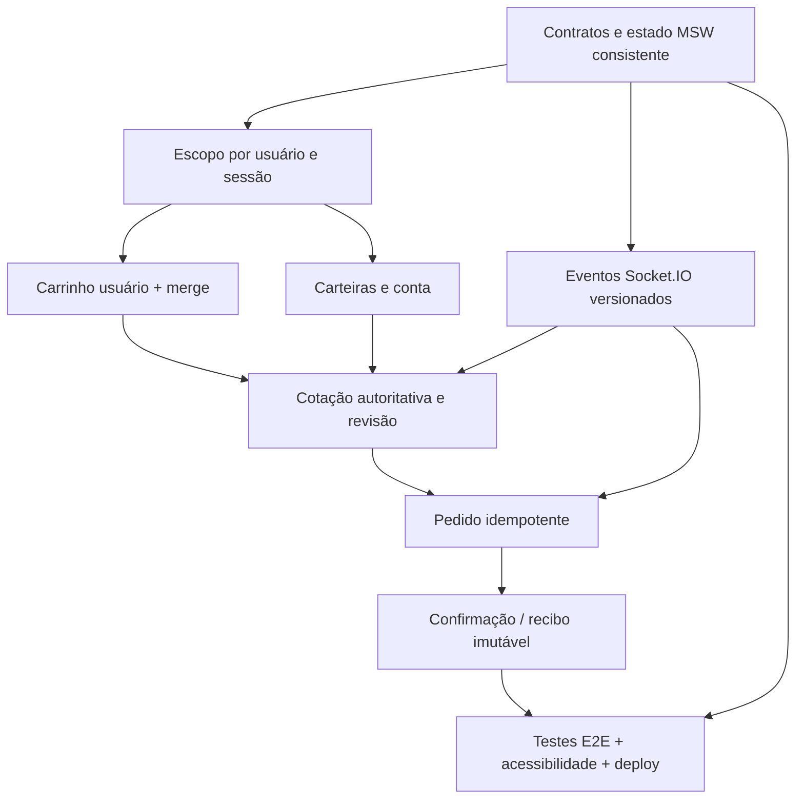

# NFT Marketplace — Próximos passos de desenvolvimento

> **Versão:** 1.0 — 05/11/2026<br>
> **Base:** `TASKS.md` compartilhado pelo candidato e README oficial do desafio.<br>
> **Objetivo:** concluir os fluxos essenciais da aplicação sem reimplementar as telas e a autenticação já existentes.<br>
> **Legenda:** `[x]` concluído *conforme evidência relatada*; `[ ]` não concluído ou ainda não comprovado.

## 0. Estado atual (verificado apenas pelo registro de progresso)

| Área | O que o TASKS.md registra | O que falta comprovar/implementar |
|---|---|---|
| Fundação | Vite, React, TS, Router, Query, Axios, MSW, Playwright, builds e smoke tests | DTOs compartilhados; cenários de reset; deploy público; socket robusto |
| Catálogo | Home, filtros/URL, ordenação, paginação e detalhe, com mobile | Respostas fora de ordem, erros/retries, galeria, favoritos, testes E2E formais |
| Autenticação | Login, cadastro, logout, sessão e proteção inicial do checkout | Expiração em tela aberta, isolamento total A→B, limpeza de Query/socket, autorização de pedidos |
| Perfil | Nome, avatar e senha com persistência simulada | E-mail e carteiras, controles de conflito e revisões de autorização |
| Carrinho | Carrinho visitante em IndexedDB, itens, quantidades, cupons e cotação via MSW | Carrinho por usuário, merge transacional, alterações em tempo real, proteção contra cotações obsoletas |
| Checkout | Interface desktop/mobile, resumo e cotação | Carteira/rede, validação e confirmação real, pedido idempotente e reconciliação |
| Pedidos | Prévia demonstrativa independente | Pedido real simulado pendente/confirmado/recusado, recibo snapshot e recuperação |
| Qualidade | Vários testes direcionados, build/typecheck e inspeções visuais | Cobertura E2E exigida, baselines, relatório Lighthouse, deploy e documentação final |

**Não tratar como concluído** um item simplesmente porque a tela existe. Os testes descritos são evidências históricas da execução no documento, não resultados reexecutados por este plano.

## 1. Regras que nunca podem ser quebradas

1. Manter uso efetivo de **React, TypeScript, TanStack Router, TanStack Query, Axios, REST, Socket.IO, Tailwind, shadcn/ui, MSW, Playwright e Lighthouse**.
2. Componentes não acessam fixtures diretamente; REST via Axios e eventos por `socket.io-client` usando mecanismo MSW compatível.
3. Nenhuma compra é confirmada só por estado visual. O pedido deve existir na API simulada e estar **confirmado**.
4. Dados de usuários distintos (sessão, perfil, favoritos, carteiras, carrinho, pedidos e cache) não podem vazar entre contas.
5. Valores ETH trafegam como **strings decimais** e são operados por biblioteca de precisão decimal.
6. Reconexão ou timeout não pode criar pedidos duplicados; pedidos têm chave de idempotência.
7. O build publicado precisa funcionar com mocks, acesso direto às rotas e refresh.
8. Manter funcionalidades não implementadas indisponíveis — nunca simular sucesso.

## 2. Dependências técnicas



## 3. Backlog na ordem de execução

### BLOCO A — Fundação mínima pendente (P0)

**A1. Contratos e query keys compartilhadas (`M0-02`).**
- [ ] Criar interfaces/Zod para `User`, `Session`, `NFT`, `Edition`, `CatalogFilters`, `Cart`, `CartItem`, `Quote`, `Wallet`, `Order`, `OrderReceipt`.
- [ ] Definir tipos e códigos de erro estáveis: `VALIDATION`, `UNAUTHORIZED`, `FORBIDDEN`, `NOT_FOUND`, `CONFLICT`, `OUT_OF_STOCK`, `QUOTE_CHANGED`, `TIMEOUT`.
- [ ] Padronizar queries por recurso, parâmetros e `userId`/`sessionScope` quando privado; configurar invalidação e retry documentados.
- [ ] Não alterar contratos estabelecidos sem atualizar handlers MSW, hooks e testes relacionados.

**Aceite:** rotas, camada de transporte e mocks importam os mesmos contratos; `typecheck` e build passam.

**A2. Repositório simulado persistente e cenários (`M0-05`).**
- [ ] Duas contas fictícias e cenários determinísticos (sucesso, 4xx/5xx, latência, falta de rede, conflito de preço e estoque).
- [ ] Implementar reset integral que inclui pedidos, carrinhos, favoritos e carteiras.
- [ ] Evitar dados duplicados/incoerentes entre GET e mutations.

**Aceite:** reset garante mesmas fixtures; refresh mantém estado, troca de usuário isola dados.

**A3. Deploy de verificação (`M0-06`, em paralelo).**
- [ ] Publicar a versão atual sem esperar pelo checkout.
- [ ] Confirmar service worker do MSW e conexão Socket.IO no build publicado.
- [ ] Confirmar acesso direto, refresh e 404 para URLs profundas.

### BLOCO B — Sessão, isolamento e carrinho (P0)

**B1. Escopo e encerramento de sessão (`M2-01/02`).**
- [ ] Interceptar expiração de sessão em tela aberta, não apenas após refresh.
- [ ] Cancelar/limpar queries privadas no logout e na troca de usuário.
- [ ] Encerrar listeners e subscriptions do usuário anterior.
- [ ] Garantir que usuário B não consulta perfil, carteiras, carrinho, favoritos nem pedido de A, inclusive por URL direta.
- [ ] Preservar rota local de retorno após login (rejeitar redirect externo).

**Aceite:** teste A→logout→B sem dados residuais e requisição de pedido alheio retorna `403` ou `404` consistente.

**B2. Carrinho de conta e merge (`M3-01/02`).**
- [ ] Implementar armazenamento de carrinho por usuário, mantendo carrinho visitante separado.
- [ ] No login/cadastro, mesclar carrinho convidado uma única vez, com política documentada para itens coincidentes, estoque insuficiente e edições indisponíveis.
- [ ] Atualizar quantidades, remoção e cupons via API simulada, sem setters de negócio no componente.
- [ ] Testar refresh, logout, troca A/B, merge repetido e conflito de estoque.

**Aceite:** itens persistem e não vazam; um segundo login não duplica itens.

### BLOCO C — Carteiras, cotação e compra (P0)

**C1. Carteiras (`M2-04`, `M4-01`).**
- [ ] CRUD das carteiras principal e secundária, validação de campos e persistência por usuário.
- [ ] Seleção de rede, simulação de conexão, recusa e desconexão.
- [ ] Sem conexão real a blockchain ou gateway; não guardar segredos/chaves privadas reais.

**Aceite:** carteira cadastrada aparece no checkout e sobrevive a refresh; conta B não vê carteira A.

**C2. Cotação autoritativa (`M3-03/04`, `M4-02`).**
- [ ] Calcular preço, desconto, taxa e total na API, usando `decimal.js` ou equivalente.
- [ ] A cotação deve ter identificador/versão e representar estoque, cupom e rede atuais.
- [ ] Revalidar antes de confirmar; alterações exigem reconfirmação explícita.
- [ ] Bloquear clique de compra com quote vencida ou diferente da revisão exibida.

**Aceite:** alterar preço ou estoque entre carrinho e checkout gera aviso e impede pedido com cotação antiga.

**C3. Pedidos idempotentes e recibo (`M4-03`).**
- [ ] Criar contrato de pedido com cabeçalho `Idempotency-Key` e hash/conteúdo da tentativa.
- [ ] Mesma chave + mesmo conteúdo retorna mesmo pedido; mesma chave + conteúdo diferente retorna conflito.
- [ ] Estados: `pending`, `confirmed`, `declined`; confirmed/declined são terminais.
- [ ] Simular timeout após commit e permitir recuperar pedido sem nova compra.
- [ ] Debitar do carrinho somente os itens e quantidades efetivamente comprados após confirmação.
- [ ] Gerar recibo com **snapshot imutável** de preços, taxas, itens, IDs e totais.
- [ ] Confirmação só para pedido de estado confirmed e autorizado ao usuário atual.

**Aceite:** checkout real simulado do catálogo ao recibo; clique duplo/retry/refresh não duplicam pedido.

### BLOCO D — Eventos em tempo real (P0)

**D1. Assinaturas Socket.IO reais (`M4-04/05`).**
- [ ] Eventos `nft.updated` e `order.updated` transportados pelo `socket.io-client` e binding MSW.
- [ ] Identidade estável, versão e escopo do usuário em cada evento; descartar duplicatas/antigos.
- [ ] Atualizar queries do catálogo, detalhe, carrinho e status de pedido com invalidação/reconciliação.
- [ ] Reconsultar recursos ativos após reconexão; destruir subscriptions da sessão encerrada.
- [ ] Cenários reprodutíveis: NFT com preço alterado no carrinho; pedido pendente com desconexão e retomada.

**Aceite:** testes verificam efeitos após evento via transporte de socket (não disparo direto de setter ou cache no teste).

### BLOCO E — Complementos de negócio e erros (P1)

- [ ] **Favoritos:** conta autenticada, persistência por usuário, atualização otimista e rollback em erro (`M2-03`).
- [ ] **Catálogo:** latência variável, cancelamento/respostas obsoletas, falha com retry, estados vazios, URL/back-forward (`M1-02/04`).
- [ ] **Detalhe:** galeria, imagens/alt, 404, edição esgotada e limites de estoque (`M1-03`).
- [ ] **Conta:** edição de e-mail e erros de validação/conflito quando cabível (`M2-04`).
- [ ] **A11y:** foco de drawers/diálogos, ARIA, labels, zoom, reduced motion, skeletons com shimmer (`M5-01`).

> Recuperação de senha e login social não aparecem como obrigações no README fornecido; não devem ocupar o caminho crítico. Botões inativos precisam informar a indisponibilidade sem sugerir sucesso.

### BLOCO F — Provas e entrega (P0/P1)

- [ ] E2E de busca/filtros/URL/histórico e detalhe/404.
- [ ] E2E de cadastro, login, expiração, logout, troca A/B e favoritos com falha.
- [ ] E2E de carrinho/merge/cupom/refresh, compra completa, pagamento recusado, timeout, clique duplo.
- [ ] E2E de perfil, senha, avatar e carteiras com validação.
- [ ] E2E de preço alterado via Socket.IO, eventos antigos, desconexão e recuperação.
- [ ] E2E de teclado/foco, skeletons, loading lento/erro/retry.
- [ ] Executar Chromium desktop/mobile; versionar screenshots baseline de Home, detalhe, carrinho e checkout; anexar traces e relatório HTML.
- [ ] Lighthouse em Home e detalhe, desktop/mobile, **3 medições por página e perfil**; registrar medianas, LCP, CLS e TBT e justificar desvios das metas.
- [ ] Documentar README com credenciais de demonstração, reset/cenários, comandos e limitações; ARCHITECTURE com sessão, cache, checkout e socket.
- [ ] Validar checkout limpo, instalação, testes, build, preview e URL pública, com refresh em rotas protegidas e mocks ativados.

## 4. Ordem de delegação aos agentes

1. **Agente de contratos/mocks** — contratos + dados simulados consistentes. É o único responsável pela modificação dos contratos compartilhados.
2. **Agente de conta/carrinho** — escopo A/B, merge e carteira, depois dos contratos estabilizados.
3. **Agente de checkout** — quote, idempotência, pedidos e recibo, após carrinho/carteira.
4. **Agente realtime** — eventos, controle de versão e reconciliação, integrando com contratos estáveis.
5. **Agente QA** — Playwright e acessibilidade em paralelo; não alterar lógica de negócio sem aprovação.
6. **Agente de integração/release** — compilar, revisar diffs, reexecutar testes e publicar.

**Protocolo de entrega por agente:** resumo de arquivos alterados, requisitos atendidos, testes executados e seus resultados reais, riscos, pendências e pontos de conflito. Evitar dois agentes editando o mesmo arquivo compartilhado simultaneamente.

## 5. Critérios de conclusão de cada tarefa

- [ ] Contrato/feature identificados por ID de requisito.
- [ ] Fluxo principal e ao menos uma falha observável implementados.
- [ ] Estado privado corretamente isolado e tratado no logout.
- [ ] `npm run typecheck` e `npm run build` passaram.
- [ ] Teste E2E pertinente foi executado em build de preview.
- [ ] Mobile e desktop validados para a tela afetada.
- [ ] Mudanças de contrato/cenário documentadas.
- [ ] Nenhum resultado de teste ou funcionalidade é marcado como aprovado sem evidência.

## 6. Se o prazo ficar crítico

**Não retirar requisitos eliminatórios silenciosamente.** Priorizar primeiro: fluxo completo de compra com MSW e pedido idempotente; isolamento entre usuários; socket efetivamente transportado; ao menos testes E2E executáveis demonstrando esses fluxos; publicação funcional. Em paralelo, executar e registrar as verificações completas exigidas. Se a entrega ficar incompleta, relatar limitações com transparência, em vez de afirmar que tudo funciona.

## 7. Primeiro prompt para o Codex

```text
Leia o README oficial do desafio, AGENTS.md, ARCHITECTURE.md, TASKS.md e PROXIMOS_PASSOS_JUNGLE_GAMING.md.
O frontend e parte da autenticação já existem: não recrie essas funcionalidades.
Comece exclusivamente pelos blocos A1 e A2: contratos tipados/Zod, query keys por usuário e estado MSW persistente com reset e dois usuários.
Respeite os endpoints e tipos existentes; proponha compatibilizações antes de modificar contratos públicos.
Implemente incrementalmente, escreva os testes correspondentes e execute typecheck, build e testes de preview.
No fim, informe diffs, testes realmente executados, resultados, pendências e requisitos impactados.
Não marque como concluído o que não foi validado.
```

---

**Nota:** este documento é uma priorização baseada no `TASKS.md` compartilhado, não uma inspeção do código do repositório. A confirmação de cada item depende de executar e revisar a implementação real.
