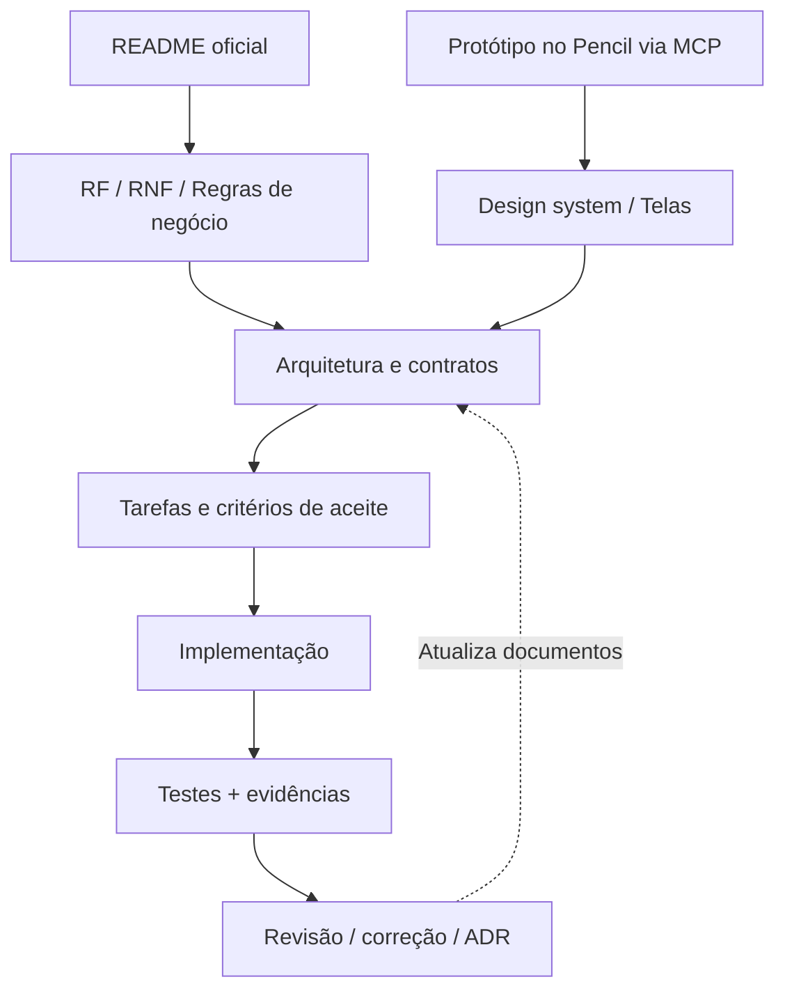

# Contrato de documentação — como evitar desvio de escopo

## Hierarquia de verdade

1. **README oficial da Jungle Gaming**: requisitos de avaliação, eliminatórios, entrega e escopo.
2. **Protótipo no Pencil (pen.dev), acessado via MCP**: referência de inspeção para aspectos visuais e composição; estados ausentes são projetados coerentemente. A correspondência com o design oficial deve ser validada.
3. **RF/RNF/RN**: interpretação normalizada em requisitos, qualidade e regras.
4. **Contratos/ADRs**: decisões de como implementar o comportamento sem alterar requisitos.
5. **TASKS e testes**: plano executável e evidências, nunca justificativa para eliminar requisito.

## Status do requisito e da tarefa

- `ESPECIFICADO`: descrito e revisado, mas ainda não implementado.
- `EM_IMPLEMENTAÇÃO`: trabalho começou; não assumir resultado.
- `IMPLEMENTADO`: existe código verificável.
- `TESTADO`: há teste ou evidência manual executada e anexada.
- `ACEITO`: cumprimento revisado contra README e protótipo acessado pelo MCP do Pencil.
- `BLOQUEADO`: requisito depende de insumo não validado.

## Processo mínimo por mudança

1. Identificar IDs RF/RNF/RN e funcionalidades afetadas.
2. Atualizar contrato e/ou ADR antes de alterar compatibilidade de API.
3. Definir caso feliz, falha e recuperação; considerar segurança e acessibilidade.
4. Implementar um vertical slice; testes junto com lógica.
5. Rodar typecheck/lint/unit/E2E afetados; manter evidência da execução.
6. Atualizar TASKS, riscos, README e limitações sem declarar testes não executados.

## Revisão de mudanças de produto

Nenhum agente altera contratos, eventos, stack, identidade ou regras de idempotência unilateralmente. Mudanças de arquitetura devem apontar impactos em consumidores e cenários.

[Requisitos funcionais](../01-visao-geral/requisitos-funcionais.md) · [Requisitos não funcionais](../01-visao-geral/requisitos-nao-funcionais.md) · [Governança](../07-planejamento/governanca-de-mudancas.md).
