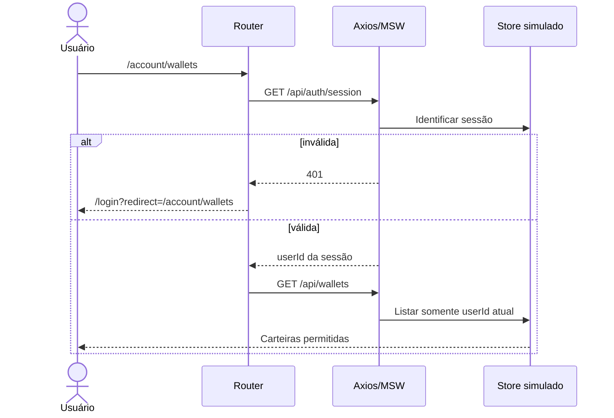

# Atores, perfis de acesso e autorização

## Atores

- **Visitante:** navega por catálogo/detalhes, usa busca e mantém carrinho visitante. Não acessa operações privadas.
- **Colecionador autenticado:** visitante com sessão válida; compra simulada, favoritos, perfil, carteiras e pedidos.
- **Camada simulada de API (MSW):** valida permissão pelo contexto da sessão e mantém dados de domínio. É ator técnico, não perfil humano.
- **Sistema de eventos Socket.IO:** propaga versões/alterações da simulação, sem permitir consulta de dados privados de outra sessão.
- **Avaliador Playwright:** executa cenários determinísticos e limpa fixtures no começo de cada teste.

## Matriz de autorização

| Funcionalidade | Visitante | Colecionador autenticado | Observações |
|---|:---:|:---:|---|
| Catálogo/detalhe | ✓ | ✓ | URLs públicas |
| Carrinho | ✓ | ✓ | Visitante → merge no login |
| Favoritos | ✕ | ✓ | Escopo do proprietário |
| Checkout e cotação final | ✕ | ✓ | Retorno à intenção após login |
| Pedidos/recibo | ✕ | ✓ | Só titular; validar na API |
| Perfil/senha/avatar | ✕ | ✓ | Persistente no mock |
| Carteiras | ✕ | ✓ | Principal e secundária |
| Reset de fixtures | Ambiente de teste | Ambiente de teste | Controle dedicado; nunca interação de produto |

## Sequência de proteção

**Invariante:** esconder links não é autorização. Mesmo que o visitante conheça URLs e identificadores, MSW deve recusar recursos privados sem sessão/dono correto.

[Regras de negócio](regras-de-negocio.md) · [Segurança](../06-qualidade/seguranca-aplicacional.md).
