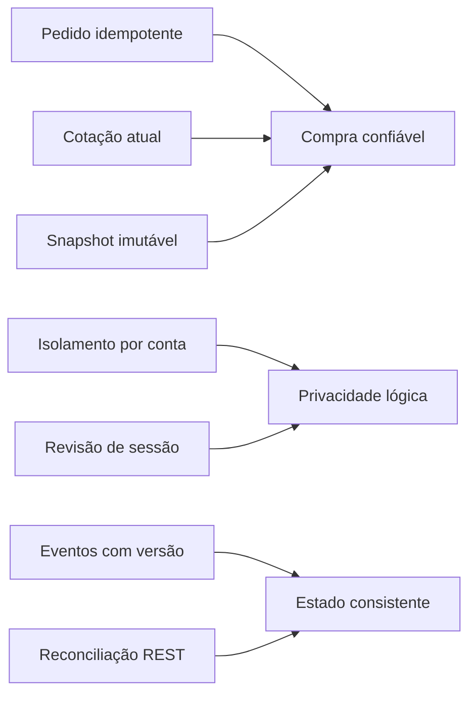

# Regras de negócio e invariantes (RN)

> **Origem:** interpretação operacional do README oficial. Regras numéricas não especificadas nele (p.ex. prazo da cotação ou limites máximos de CPF) devem ser definidas por ADR e marcadas [PROPOSTO], jamais tratadas como exigência.

| ID | Invariante |
|---|---|
| **RN-001** | O carrinho identifica uma linha por NFT + edição, não apenas NFT. |
| **RN-002** | Quantidade sempre é inteiro positivo, limitada à disponibilidade da edição. |
| **RN-003** | Mudança de filtro reinicia paginação; URL persiste busca, filtros, ordenação e página. |
| **RN-004** | Preço, estoque, cupom, taxa e total da API têm precedência sobre cálculos da tela. |
| **RN-005** | ETH usa strings decimais no transporte e aritmética decimal exata. |
| **RN-006** | Favoritos, perfil, carteiras e pedidos só pertencem ao usuário autenticado. |
| **RN-007** | Visitante pode ter carrinho local; login incorpora itens do visitante uma só vez. |
| **RN-008** | A fusão de itens precisa tratar colisões de edição e falta de estoque sem inventar sucesso. |
| **RN-009** | Checkout exige sessão, dados válidos e carteira/rede selecionadas. |
| **RN-010** | Antes de confirmar compra, gerar cotação atual; mudanças exigem aceite explícito. |
| **RN-011** | Chave de idempotência identifica tentativa lógica; repetir payload retorna mesmo pedido. |
| **RN-012** | Reutilizar chave com payload diferente produz conflito, sem novo pedido. |
| **RN-013** | Timeout após criar pedido não autoriza reenvio cego; consultar tentativa por chave. |
| **RN-014** | Apenas confirmed gera recibo de sucesso; declined/pending nunca exibem confirmação final. |
| **RN-015** | Recibo é snapshot imutável de itens/valores/taxas no instante do pedido. |
| **RN-016** | Falha preserva carrinho; confirmação remove apenas unidades compradas. |
| **RN-017** | Atualização nft.updated invalida cotação e atualiza catálogo, detalhe e carrinho. |
| **RN-018** | order.updated não pode reverter status terminal nem versões mais recentes. |
| **RN-019** | Após reconexão, REST reconcilia dados ativos; evento sozinho não reautoriza compra. |
| **RN-020** | Troca de conta cancela queries privadas, descarta listeners/socket e limpa cache antigo. |
| **RN-021** | Session 401 no checkout exige login e revalidação sem perder contexto seguro. |
| **RN-022** | APIs autorizam acesso por identidade da sessão, nunca pelo userId do request. |
| **RN-023** | Mocks REST e Socket.IO compartilham mesmo armazenamento e versões. |
| **RN-024** | Fixtures de testes possuem pelo menos dois usuários e reset atômico conhecido. |
| **RN-025** | Ações fora de escopo não produzem sucesso enganoso. |
| **RN-026** | Credenciais e endereços de carteira são fictícios; sem operações blockchain reais. |
| **RN-027** | Edição de NFT indisponível não pode entrar no carrinho. |
| **RN-028** | Estado vazio e erro devem sempre oferecer feedback e recuperação quando cabível. |
| **RN-029** | Mudanças no catálogo não modificam pedido já confirmado. |
| **RN-030** | Status de pedido confirmed ou declined é terminal. |

## Invariantes que nenhum agente pode quebrar

## Exemplos de decisão explícita [PROPOSTO]

| Tema | Estratégia padrão recomendada | Risco a validar |
|---|---|---|
| Merge de carrinho | Para NFT+edição iguais, somar quantidades até estoque; excedente gera conflito informativo | Não apagar excedente silenciosamente |
| Pedido em timeout | Recuperar pela chave antes de permitir nova tentativa | Persistência e atomicidade |
| Expiração da cotação | TTL definido em fixture configurável; toda confirmação revalida | Sem TTL oficial no README |
| Cupons | Aplicar desconto conforme API, nunca recalcular autonomamente na tela | Tipos e limites dos cupons ainda são propostas |

[Fluxos do usuário](../02-produto/jornadas-e-fluxos.md) · [Modelos de estado](../05-integracoes/maquinas-de-estado.md) · [Idempotência](../05-integracoes/idempotencia-e-recuperacao.md).
