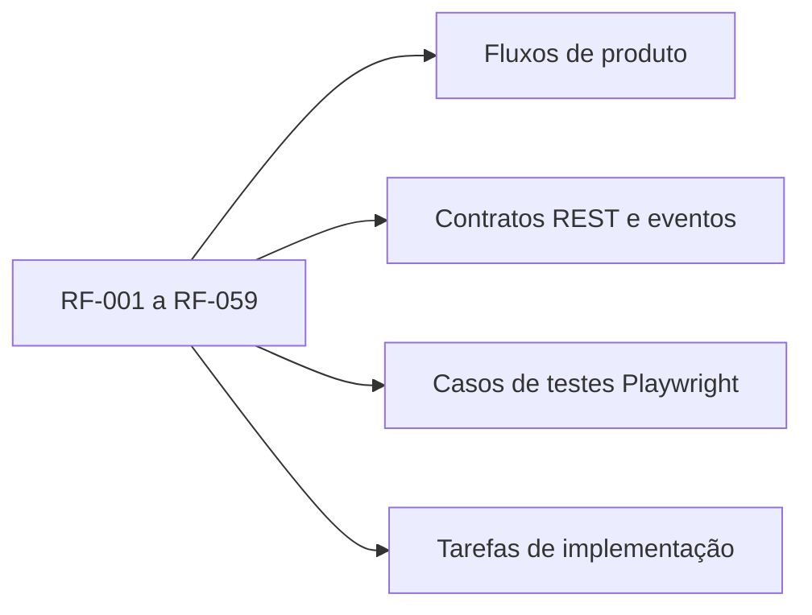

# Catálogo de requisitos funcionais (RF)

> **Fonte:** README oficial da Jungle Gaming, seções 3–10 e 12. **Estado:** requisitos de produto para implementar; nenhum está validado pelo simples fato de constar aqui.

## Convenções

- `RF-xxx`: identificador estável; não renumerar após implementação.
- **Obrigatório**: requisito presente no enunciado, resumido sem alterar sua intenção.
- A coluna **Aceite observável** é uma operacionalização proposta para teste.
- Cada mudança relevante deve atualizar contrato, UI, testes, matriz e `TASKS.md`.

## Mapa de cobertura

## Catálogo e descoberta

| ID | Requisito obrigatório | Aceite observável |
|---|---|---|
| **RF-001** | Exibir destaques e itens do catálogo de NFTs | Dado o cenário padrão, a página inicial exibe destaques e dados obtidos via Axios/MSW. |
| **RF-002** | Pesquisar NFTs por texto | Após pesquisar, a URL contém o termo e a API recebe a busca aplicada. |
| **RF-003** | Combinar filtros do catálogo | Dois ou mais filtros coexistem e afetam o resultado sem sobrescrever os anteriores. |
| **RF-004** | Ordenar resultados | A opção de ordenação altera a URL, a requisição e a ordem de exibição. |
| **RF-005** | Paginar resultados | Navegação de página respeita o total da API e os limites válidos. |
| **RF-006** | Restaurar estado de catálogo por URL e histórico | Refresh, back e forward preservam busca, filtros, ordenação e página. |
| **RF-007** | Reiniciar paginação ao mudar filtros | Ao aplicar ou remover um filtro, a página atual retorna a 1. |
| **RF-008** | Tratar estados de catálogo | Loading/skeleton, vazio, falha e retry aparecem sem resultados fantasmas. |
| **RF-009** | Exibir detalhe por acesso direto | Uma URL de NFT válida abre detalhe; identificador desconhecido mostra recurso inexistente. |
| **RF-010** | Exibir galeria, edições e disponibilidade | Galeria e edições refletem preço, quantidade máxima e status retornados pela API. |
| **RF-011** | Selecionar edição e quantidade válida | Edição indisponível não pode ser comprada; quantidade excedente é impedida. |

## Identidade e conta

| ID | Requisito obrigatório | Aceite observável |
|---|---|---|
| **RF-012** | Cadastrar conta fictícia | Campos validados; criação bem-sucedida persiste após refresh; e-mail duplicado retorna conflito. |
| **RF-013** | Realizar login de conta existente | Credenciais válidas iniciam sessão; inválidas mostram erro sem revelar detalhes sensíveis. |
| **RF-014** | Restaurar sessão após refresh | Sessão válida é restaurada por API simulada e usuário inválido retorna a estado anônimo. |
| **RF-015** | Expirar e encerrar sessão | Após expiração ou logout, operações privadas deixam de ser autorizadas. |
| **RF-016** | Proteger rotas e retomar intenção original | Acesso privado redireciona para login e retorna ao destino após autenticação. |
| **RF-017** | Isolar dados entre duas contas | Troca A→B não expõe perfil, favoritos, carteiras, pedidos ou eventos de A. |
| **RF-018** | Consultar e alterar perfil | Edição validada é salva via API e permanece após refresh. |
| **RF-019** | Alterar avatar e senha | Erros de validação e da API são exibidos; dados confirmados persistem. |
| **RF-020** | Gerenciar carteiras principal e secundária | Cadastro e edição validada de carteiras com escopo da sessão, persistência e regras de principal. |
| **RF-021** | Simular conexão, recusa e desconexão de carteira | Cada decisão aparece na UI e bloqueia a ação quando conexão exigida está indisponível. |
| **RF-022** | Consultar pedidos apenas do titular | Pedido de outra conta nunca retorna conteúdo privado nem pelo acesso direto. |

## Favoritos e carrinho

| ID | Requisito obrigatório | Aceite observável |
|---|---|---|
| **RF-023** | Adicionar e remover favoritos autenticados | Favorito persiste por identidade e ao menos uma mutation usa atualização otimista com rollback. |
| **RF-024** | Adicionar NFT/edição ao carrinho | Adição respeita edição, disponibilidade e quantidade inteira positiva. |
| **RF-025** | Atualizar quantidades e remover linhas | Resumo exibe quantidade atualizada e remoção persistente após refresh. |
| **RF-026** | Persistir carrinho do visitante | Visitante retorna após refresh com seu carrinho conservado. |
| **RF-027** | Mesclar carrinho do visitante no login | Itens são transferidos uma vez para a conta, com resolução documentada de conflitos. |
| **RF-028** | Aplicar e remover cupom | Descontos seguem resposta de cotação; código inválido/expirado apresenta erro explícito. |
| **RF-029** | Exibir totais corretos e cotados | Subtotal, desconto, taxa e total usam strings ETH decimais e respeitam a API. |
| **RF-030** | Refletir alterações de preços e estoque no carrinho | Evento de NFT altera dados visíveis e sinaliza necessidade de revalidação. |

## Checkout e pedidos

| ID | Requisito obrigatório | Aceite observável |
|---|---|---|
| **RF-031** | Iniciar checkout autenticado | Usuário anônimo precisa autenticar-se e o carrinho permanece disponível. |
| **RF-032** | Validar dados do colecionador | Campos obrigatórios e erros são associados aos inputs sem permitir avanço inválido. |
| **RF-033** | Selecionar carteira e rede | Checkout utiliza carteiras cadastradas e estado da conexão simulada. |
| **RF-034** | Obter cotação autoritativa | Requisição recalcula preço, taxa, desconto e estoque antes da confirmação. |
| **RF-035** | Exigir reconfirmação após mudança | Quando preço, estoque, cupom ou taxa mudam, total anterior não pode ser confirmado. |
| **RF-036** | Submeter compra com chave de idempotência | Clique repetido ou retry conserva mesma chave para a mesma tentativa. |
| **RF-037** | Recuperar pedido após timeout | Ao desconhecer resultado, consulta por chave identifica o mesmo pedido sem duplicar. |
| **RF-038** | Exibir estados pendente, confirmado e recusado | Recibo de sucesso é mostrado apenas para pedido confirmado, nunca para pendente/recusado. |
| **RF-039** | Retomar pedido após refresh/reconexão | Pedido pendente volta ao estado correto após reconsulta REST e eventos. |
| **RF-040** | Guardar recibo imutável | Snapshot do pedido não muda quando os NFTs do catálogo mudam posteriormente. |
| **RF-041** | Preservar carrinho em falha e decrementar após confirmação | Falhas preservam itens; sucesso retira somente quantidade comprada. |
| **RF-042** | Representar referência de transação simulada | Referência e link de exploração fictícios são identificados como simulados. |

## Tempo real e recuperação

| ID | Requisito obrigatório | Aceite observável |
|---|---|---|
| **RF-043** | Consumir evento nft.updated via socket.io-client | Atualização altera preço/estoque nas consultas ativas sem mutação direta na UI. |
| **RF-044** | Consumir evento order.updated via socket.io-client | Pedido em andamento sincroniza status pelo evento e confirma por consulta válida. |
| **RF-045** | Descartar eventos obsoletos e duplicados | Versão igual/menor não regride dados; o mesmo evento não reaplica efeitos. |
| **RF-046** | Reconciliar após reconexão | Após voltar à rede, consulta REST corrige estado local antes de permitir decisão crítica. |
| **RF-047** | Liberar listeners ao encerrar sessão ou tela | Não há propagação de eventos de conta anterior nem listeners duplicados. |
| **RF-048** | Executar cenários reprodutíveis de falha de rede | Latência, timeout, offline, 4xx/5xx e respostas fora de ordem são reproduzíveis via MSW. |
| **RF-049** | Disponibilizar reset de fixture e estado | Reset restaura integralmente um cenário conhecido sem vazamento entre testes. |

## Interface, testes e operação

| ID | Requisito obrigatório | Aceite observável |
|---|---|---|
| **RF-050** | Implementar nove telas obrigatórias | Home, detalhe, carrinho, pagamento, confirmação, login, cadastro, perfil e carteiras existem. |
| **RF-051** | Adaptar todas as telas ao mobile | Telas e fluxos operam em 390, 768 e 1440 px sem overflow indevido. |
| **RF-052** | Exibir skeleton shimmer durante carregamento | Catálogo, detalhe e resumo do carrinho preservam geometria; reduced motion respeitado. |
| **RF-053** | Dar feedback acessível a ações e erros | Loading, confirmação, erro e evento de tempo real são compreensíveis sem cor isolada. |
| **RF-054** | Executar testes E2E nos fluxos definidos | Playwright exercita 12 cenários do desafio, em Chromium mobile e desktop. |
| **RF-055** | Executar regressão visual | Baselines reproduzíveis para início, detalhe, carrinho e checkout versionadas. |
| **RF-056** | Executar auditorias Lighthouse | Três execuções por página/perfil com mediana e LCP, CLS e TBT registrados. |
| **RF-057** | Disponibilizar deploy público independente | Build publicado abre rotas diretamente, refresh e mocks operam sem backend privado. |
| **RF-058** | Fornecer documentação operacional | README explica setup, mocks, cenários, reset, usuários de demonstração e comandos. |
| **RF-059** | Tratar páginas não encontradas e ações fora de escopo | Rota inválida mostra fallback; links auxiliares não anunciam sucesso falso. |

## Regras de execução e revisão

1. Cada RF deve ter pelo menos um teste automatizado ou evidência manual repetível; RFs críticos de identidade e compra exigem E2E.
2. Critérios de aceite só podem ser marcados como aprovados após execução no build testado.
3. Requisitos que dependam de inspecionar o protótipo via MCP do Pencil ficam `VALIDAR` até o inventário de frames/assets.

**Leitura complementar:** [RNF](requisitos-nao-funcionais.md) · [Regras de negócio](regras-de-negocio.md) · [Matriz de testes](../06-qualidade/matriz-de-testes-e-requisitos.md) · [Jornadas](../02-produto/jornadas-e-fluxos.md).
