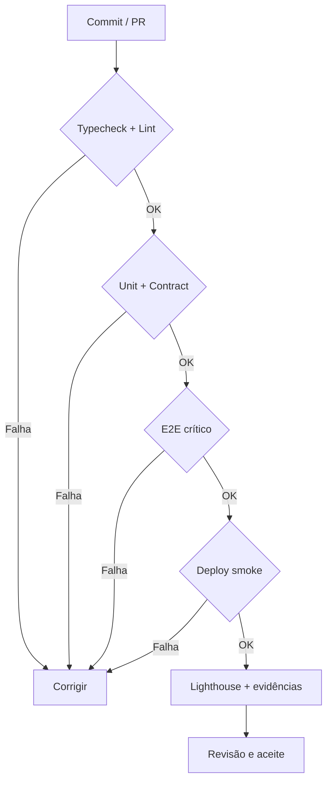

# Requisitos não funcionais (RNF)

Especificam **como** a solução deve se comportar. Requisitos explícitos do desafio são `Exigido`; recomendações de engenharia são `Proposta` e não devem ser atribuídas à empresa.

| ID | Dimensão | Critério mensurável / evidência | Verificação | Origem |
|---|---|---|---|---|
| **RNF-001** | Compatibilidade | Aplicação com build React + TS e stack obrigatória exercitada; nenhuma biblioteca exigida é decorativa | Build e E2E, inspeção de imports/fluxos | Exigido |
| **RNF-002** | Responsividade | Sem perda de conteúdo ou overflow horizontal indevido em 390, 768 e 1440 px | Screenshots e teste E2E desktop/mobile | Exigido |
| **RNF-003** | Fidelidade visual | Cores, tipografia, espaçamento, composição e imagens consistentes com o protótipo inspecionado via MCP do Pencil; desvios registrados | Regressão visual com baseline versionada e revisão humana | Exigido |
| **RNF-004** | Performance | Lighthouse Performance ≥ 90 nos 4 perfis página/dispositivo exigidos | Mediana de 3 auditorias por perfil | Exigido |
| **RNF-005** | Acessibilidade auditável | Lighthouse Accessibility ≥ 95 em páginas auditadas | Mediana de 3 auditorias por perfil | Exigido |
| **RNF-006** | Boas práticas do navegador | Lighthouse Best Practices ≥ 95 | Mediana de 3 auditorias por perfil | Exigido |
| **RNF-007** | SEO técnico | Lighthouse SEO ≥ 90 | Mediana de 3 auditorias por perfil | Exigido |
| **RNF-008** | Métricas vitais | Registrar LCP, CLS e TBT nas auditorias sem omitir ativos reais | HTML/JSON versionado e resumo por mediana | Exigido |
| **RNF-009** | Acessibilidade por teclado | Todas as interações críticas operáveis por teclado e foco visível | Playwright keyboard + inspeção | Exigido |
| **RNF-010** | Acessibilidade em formulários | Labels, aria-describedby/errormessage ou equivalentes e gestão de foco | Playwright + auditoria manual | Exigido |
| **RNF-011** | Movimento reduzido | Shimmer e animações respeitam prefers-reduced-motion | Teste com media emulate reducedMotion | Exigido |
| **RNF-012** | Gestão de estados | Todas as consultas e mutations tratam loading, empty, error, success e background refresh | E2E estados parametrizados | Exigido |
| **RNF-013** | Consistência de identidade | Sem cache, eventos ou snapshots privados cruzados entre A e B | E2E troca de usuário e sessão expirada | Exigido |
| **RNF-014** | Consistência monetária | Valores ETH trafegam como strings decimais; sem cálculos com float para centésimos de ETH | Testes de precisão e reconciliação de total | Exigido |
| **RNF-015** | Confiabilidade de pedido | Idempotência e recuperação preservam single-order mesmo com clique repetido/timeout | E2E contagem de pedidos após retry | Exigido |
| **RNF-016** | Resiliência da rede | Falhas HTTP, offline, latência variável e reordenação exercitáveis em fixtures | Cenários determinísticos e E2E | Exigido |
| **RNF-017** | Higiene de subscrições | Handlers Socket.IO são removidos ao desmontar e trocar sessão | Teste eventos duplicados, reconexão e A/B | Exigido |
| **RNF-018** | Testabilidade | Cada teste parte de estado isolado; relógio/latência/eventos controlados | Suite repetível e sem flakiness conhecida | Exigido |
| **RNF-019** | Deploy reproduzível | Aplicação publicada opera mocks, realtime e refresh de rotas sem backend privado | Smoke test pela URL pública | Exigido |
| **RNF-020** | Documentação de operação | README inclui variáveis, credenciais fictícias, reset, auditoria e limitações | Revisão de checklist de entrega | Exigido |
| **RNF-021** | Cobertura de qualidade | Playwright cobre 12 cenários do enunciado e baselines | Relatório HTML e traces das falhas | Exigido |
| **RNF-022** | Validação de entrada | Zod schemas nos limites HTTP, URL e formulários; rejeitar entradas inválidas | Unit + E2E 400/422/409 | Proposta |
| **RNF-023** | Manutenibilidade | Features isoladas; nenhuma importação de mocks pela UI; lint/typecheck sem erros | Análise de dependência e CI | Proposta |
| **RNF-024** | Segurança de dados demo | Sem senhas legíveis, chaves reais ou dados pessoais nos fixtures/commits | Busca de segredos + inspeção | Proposta |
| **RNF-025** | Dependências auditáveis | Lockfile versionado; sem vulnerabilidades críticas conhecidas não justificadas | Audit report registrando exceções | Proposta |
| **RNF-026** | Observabilidade de erros | Erros apresentam mensagem recuperável; logs estruturados sem dados sensíveis | Cenários de erro e inspeção de logs | Proposta |
| **RNF-027** | Consistência de estado | Sem duplicação de dados remotos como source-of-truth em React state | Code review e testes de invalidação | Proposta |
| **RNF-028** | Suporte a texto ampliado | Aumento de zoom preserva acesso aos controles e conteúdo | Validação manual zoom 200% | Exigido |
| **RNF-029** | Estrutura de código | TypeScript strict, imports por domínio e funções coesas e testáveis | tsc + lint + PR checklist | Proposta |
| **RNF-030** | Tempo de feedback local | Setup, comandos de qualidade e cenários documentados para qualquer clone limpo | Rodar scripts num checkout novo | Proposta |

## Quality gates (propostos)

**Regra:** não inventar resultados Lighthouse ou Playwright: até executar, o status é **não verificado**. Acessibilidade deve seguir como referência proposta [WCAG 2.2 nível AA](../06-qualidade/acessibilidade.md), além dos limiares exigidos no enunciado.
