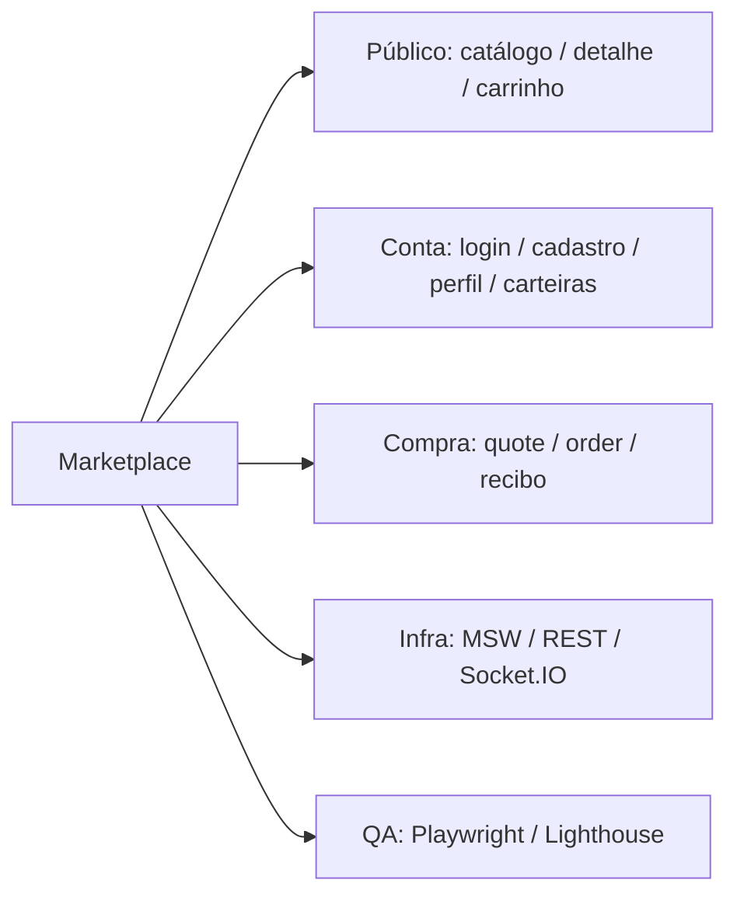

# Visão geral e objetivo

Construir uma aplicação web de marketplace de NFTs, responsiva e visualmente fiel ao protótipo inspecionado pelo MCP do Pencil, que permita ao colecionador descobrir itens, criar uma conta, manter favoritos e carrinho, simular uma compra e acompanhar o pedido. A avaliação também envolve arquitetura, integração, acessibilidade, performance e testes.

A experiência deve ser funcional de ponta a ponta, inclusive em situações de erro. As operações são simuladas por uma API com estado, e não apenas por telas estáticas.

### 1.1 Dentro e fora do escopo

| Dentro do escopo | Fora do escopo |
|---|---|
| Catálogo, busca, filtros, detalhes e favoritos | Integração real com blockchain |
| Conta, perfil, avatar e carteiras simuladas | Extensões reais de carteira |
| Carrinho, cupom, cotação, checkout e pedidos | Gateway ou pagamento real |
| Atualizações em tempo real simuladas | Páginas editoriais, suporte, atividade, ofertas e downloads |
| Mocks de rede, testes, auditoria e publicação | Fazer ações fora do escopo parecerem concluídas |

> **Atenção:** confirmação de compra exige que o pedido seja retornado como confirmado pela simulação. Uma tela de sucesso exibida somente por clique não atende ao desafio.

[← Voltar ao índice](../README.md)

## Relação entre escopo e arquitetura

[Ver jornadas completas](../02-produto/jornadas-e-fluxos.md) · [Matriz de requisitos](matriz-de-rastreabilidade.md)
