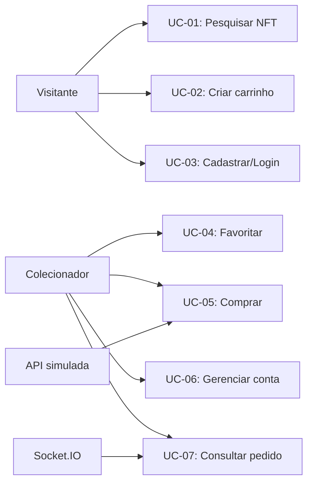

# Casos de uso — contratos de interação

## Diagrama de atores e casos

## UC-01 — Descobrir NFT

**Ator:** visitante ou autenticado. **Pré-condição:** UI inicializada; mocks disponíveis. **Pós-condição:** NFT escolhido ou resultado vazio/erro comunicado. **RF:** 001–011.

1. Abrir home, visualizar skeleton durante carregamento e itens da API.
2. Aplicar busca + múltiplos filtros + ordenação; alterar URL; reiniciar paginação quando filtra.
3. Navegar pelo histórico/refresh sem perder estado; abrir detalhe por URL.
4. Selecionar edição/quantidade válida.

**Exceções:** zero resultados → estado vazio; 404 → página de não encontrado; rede lenta → skeleton; requisição antiga → descartar resultado.

## UC-02 — Gerenciar carrinho

**Ator:** visitante ou autenticado. **Pré-condição:** NFT/edição selecionável. **Pós-condição:** linhas válidas e persistentes. **RF:** 024–030.

1. Adicionar edição e quantidade; verificar disponibilidade no mock.
2. Ajustar/remover itens; observar subtotal da cotação.
3. Atualizar página e confirmar persistência.
4. Se visitante, autenticar e fazer merge com feedback de conflitos.

**Exceções:** estoque insuficiente (409); cupom inválido/expirado; alteração de preço via evento; não abandonar itens.

## UC-03 — Autenticar e voltar ao fluxo

**Ator:** visitante. **Pré-condição:** conta existente ou criação permitida. **Pós-condição:** sessão válida e retorno ao destino seguro. **RF:** 012–017.

1. Acessar checkout → redirecionar para login com `redirect` local.
2. Autenticar/cadastrar, carregar sessão e mesclar carrinho.
3. Redirecionar para checkout; refazer consultas privadas.

**Exceções:** credenciais inválidas, cadastro em conflito, expiração durante checkout, usuário troca A→B com limpeza de cache/eventos.

## UC-04 — Finalizar compra simulada

**Ator:** colecionador autenticado. **Pré-condição:** itens válidos, carteira/rede selecionadas. **Pós-condição:** pedido pendente/confirmado/recusado, sem duplicação. **RF:** 031–042.

1. Validar dados e carteira; simular conexão.
2. Recalcular cotação na API; comparar versão e solicitar reconfirmação se necessário.
3. Criar chave de idempotência por tentativa, submeter pedido uma única vez do ponto de vista lógico.
4. Se timeout, consultar tentativa existente; acompanhar pending com REST e Socket.IO.
5. Exibir recibo apenas após confirmed; caso contrário manter contexto e informar falha.

**Exceções:** expiração de sessão; mudança de estoque; recusa de carteira; pedido recusado; desconexão e reconexão.

## UC-05 — Gerenciar conta

**Ator:** colecionador. **RF:** 018–022. **Fluxo:** abrir perfil → editar dados/avatar/senha → validar e persistir → gerenciar carteiras principal/secundária → atualizar página e verificar dados → logout. **Exceções:** erro da API, 401/403, dados inválidos.

## UC-06 — Retomar pedido

**Ator:** colecionador. **RF:** 037–040, 044–047. **Fluxo:** refresh ou reconexão → reconsultar pedido por id/chave → reconciliação de versão → exibir pending/declined/confirmed. **Invariante:** status terminal nunca regride.

**Referências:** [Jornadas](jornadas-e-fluxos.md) · [Fluxos detalhados](fluxos/checkout.md) · [RF](../01-visao-geral/requisitos-funcionais.md).
