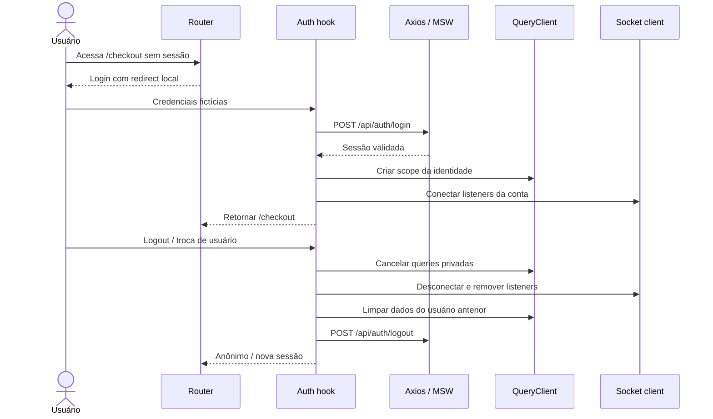

# Fluxo detalhado — login, sessão e troca de usuário

**Requisitos:** RF-012–RF-022, RN-006, RN-020–RN-022. O backend simulado é responsável por autorização, não apenas o guard da UI.

## Três pontos que evitam vazamentos

1. **API:** extrai `userId` da sessão, nunca do body enviado pelo cliente.
2. **Query:** keys privadas sempre têm scope de usuário/sessão; cancelar e remover cache antigo na troca.
3. **Socket.IO:** listeners associados à sessão têm cleanup; eventos antigos são ignorados por identidade/epoch.

## Falhas obrigatórias

- Login inválido: mensagem genérica, sem expor qual campo existe no sistema.
- Sessão expirada: redirecionar com intenção segura, sem perder carrinho, mas revalidando cotação.
- Duas contas no teste: nunca mostrar carteira/pedido/favorito do usuário A após login como B.
- Cadastro conflitante: 409 com erro de campo e opção de login.

[Autorização](../../01-visao-geral/atores-e-permissoes.md) · [Segurança](../../06-qualidade/seguranca-aplicacional.md).
