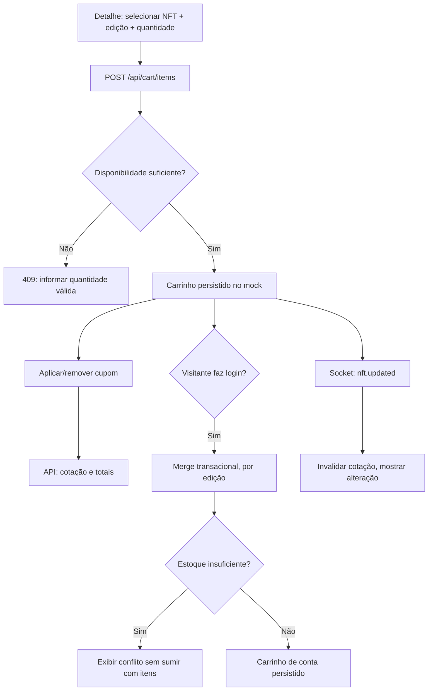

# Fluxo detalhado — carrinho, cupom e merge

## Regras de domínio

- Identidade de linha: `(nftId, editionId)` e `lineId` estável no carrinho.
- Persistência visitante **não** dá acesso a dados privados.
- Merge somente após autenticação confirmada; operação idempotente de merge ou flag transacional para não duplicar em refresh.
- `quantity` inteiro; estoque e preço verificados pela API; ETH string decimal.
- Cupom/total nunca calculados com regras secretas na UI.

## Aceite principal

- [ ] Adicionar, editar e remover linhas passa por Axios/MSW.
- [ ] Refresh conserva itens e cupom válido conforme política simulada.
- [ ] Login conserva itens visitantes, sem duplicar com duplo submit.
- [ ] Cupom inválido/expirado apresenta erro e não desconto.
- [ ] Evento de preço/estoque altera resumo e exige nova cotação.

[UC](../casos-de-uso.md) · [Contratos REST](../../05-integracoes/especificacao-de-contratos.md).
