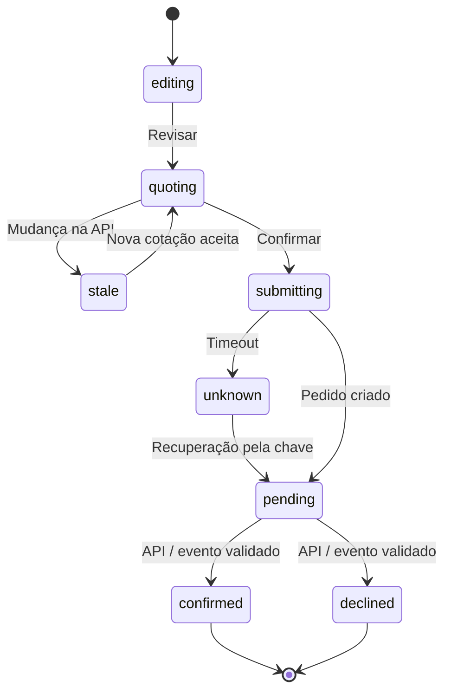

# Fluxo detalhado — compra, idempotência e recuperação

**Requisitos:** RF-031–RF-042 e RF-044–RF-046. A API simulada é a fonte da verdade para cotação e estado do pedido.

```mermaid
sequenceDiagram
  actor U as Colecionador
  participant C as Checkout React
  participant A as Axios / MSW
  participant D as Store transacional
  participant S as Socket.IO
  U->>C: Preencher dados e selecionar carteira
  C->>A: POST /api/quotes
  A->>D: Preço, estoque, cupom, rede
  A-->>C: Cotação + versão
  alt Alteração desde última revisão
    C-->>U: Revisar e aceitar novo total
  end
  U->>C: Confirmar compra
  C->>C: Gerar/reusar chave idempotente
  C->>A: POST /api/orders (Idempotency-Key)
  A->>D: Comparar chave + payload canônico
  alt Já existe tentativa idêntica
    D-->>C: Mesmo orderId
  else nova tentativa válida
    D-->>C: Pedido pending
  else chave reutilizada com payload diferente
    D-->>C: 409 IDEMPOTENCY_CONFLICT
  end
  opt Timeout após servidor criar pedido
    C->>A: GET /api/orders/by-key/:key
    A-->>C: Mesmo pedido
  end
  S-->>C: order.updated com id, userId, version
  C->>A: GET /api/orders/:id após reconexão/refresh
  alt confirmed
    C-->>U: Recibo do snapshot confirmado
  else declined
    C-->>U: Recusa; carrinho preservado
  else pending
    C-->>U: Acompanhar estado sem recriar compra
  end
```

## Máquina de estados essencial



## Invariantes testáveis

1. Não renderizar confirmação enquanto `status !== confirmed`.
2. `Idempotency-Key` e hash do mesmo payload nunca criam segundo pedido.
3. Snapshot de compra não muda com catálogo posterior.
4. Carrinho permanece após falha e decrementa **apenas** linhas/quantidades confirmadas.
5. Após expiração, recuperar sessão e **revalidar** quote; nunca repetir automaticamente a compra.

[Idempotência](../../05-integracoes/idempotencia-e-recuperacao.md) · [Máquinas de estado](../../05-integracoes/maquinas-de-estado.md) · [Testes](../../06-qualidade/matriz-de-testes-e-requisitos.md).
