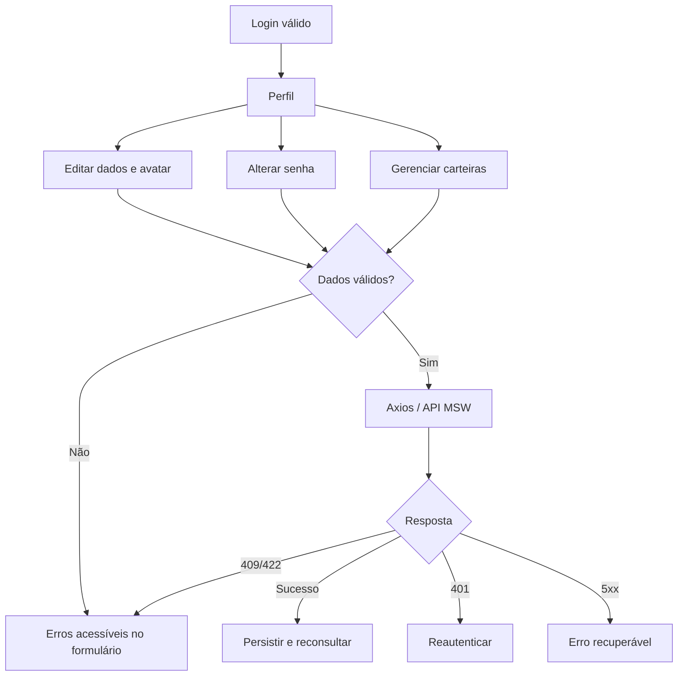

# Fluxo detalhado — perfil, senha e carteiras

## Especificação mínima

| Ação | Comportamento | API proposta |
|---|---|---|
| Carregar perfil | Skeleton, dados da sessão | `GET /api/profile` |
| Atualizar nome/avatar | Validação, persistência, toast acessível | `PATCH /api/profile` |
| Alterar senha | Não expor conteúdo em logs; retorno claro | `POST /api/profile/password` |
| Listar carteiras | Somente do usuário, principal identificada | `GET /api/wallets` |
| Adicionar/editar carteira | Validar formato/rede e conflitos | `POST/PATCH /api/wallets` |
| Selecionar no checkout | Somente carteira pertencente à sessão | `POST /api/quotes` / ordem |

## Política de demonstração

A interface simula conexão/recusa/desconexão; jamais solicita chave privada real ou carteira de produção. Uma carteira registrada é metadado fictício de pagamento.

[Permissões](../../01-visao-geral/atores-e-permissoes.md) · [Schemas](../../05-integracoes/especificacao-de-contratos.md).
