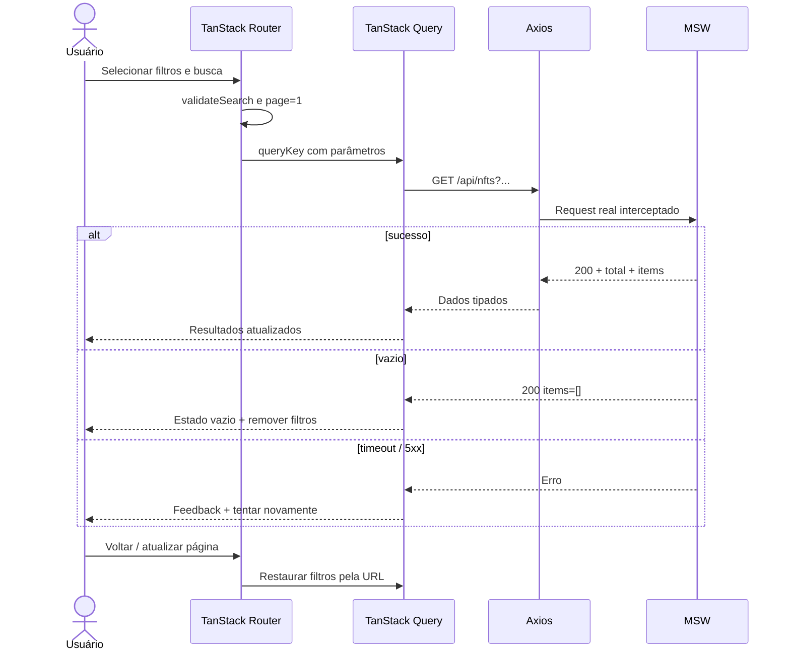

# Fluxo detalhado — descoberta, filtros e detalhe

**Atores:** visitante/colecionador. **Requisitos:** RF-001–RF-011. **Estado de URL:** `q`, filtros combinados, `sort`, `page`.

## Contrato de UX

- Inputs com label; filtros agrupados e removíveis; opção clara para limpar tudo.
- Paginação resetada quando critérios mudam; ordenação isolada do restante.
- Skeleton com altura previsível, mantendo o layout visual durante carregamento.
- No detalhe: URL direta funcional, foto/galeria, preço e estoque por edição, estados de indisponibilidade e quantidade.
- Cancelar requisições antigas via signal; query keys incluem parâmetros normalizados.

## Condições de aceite

- [ ] `?q=arte&page=2` não perde valores após refresh.
- [ ] Combinação de filtros passa todos os valores à API.
- [ ] Requisição lenta antiga não substitui consulta recente.
- [ ] Detalhe inexistente apresenta 404 recuperável.
- [ ] Edição esgotada não permite comprar.

[UC](../casos-de-uso.md) · [Arquitetura de estado](../../03-arquitetura/modelo-de-estado.md).
