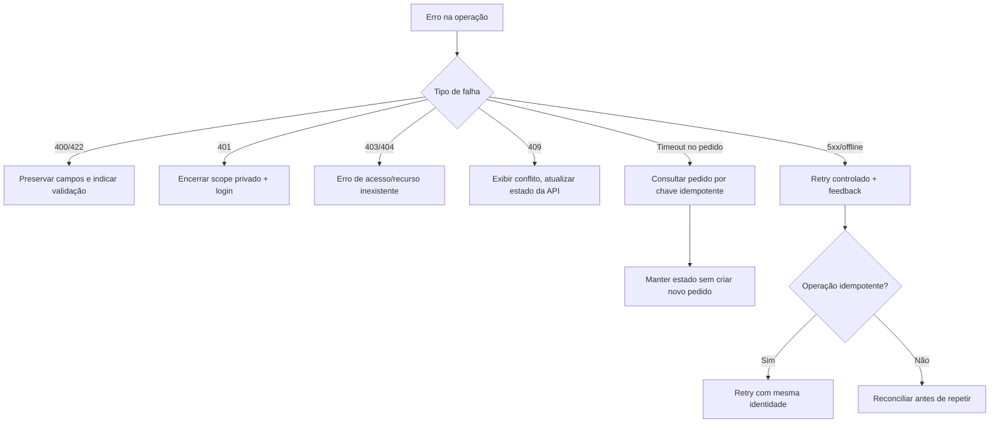

# Fluxos de exceção e recuperação

## Árvore de decisões

## Matriz de resposta de UI

| Falha | UX esperada | Persistir contexto? | Repetir automaticamente? |
|---|---|---|---|
| Busca vazia | Estado vazio + limpar filtros | URL | Não |
| Erro GET transitório | Alert + retry explícito | Query params | Pode haver retry limitado |
| Token expirado | Login + retorno à rota | Itens do carrinho/intenção | Não em mutation sensível |
| Cupom inválido | Mensagem no campo | Carrinho | Não |
| Cotação stale | Atualizar preços, exigir confirmação | Carrinho | Não confirmar automaticamente |
| Timeout após criar pedido | Estado desconhecido + recuperar por key | `attemptId` | Jamais novo POST sem verificação |
| Socket desconectado | Indicador discreto + reconciliação REST | Pedido pendente | Reconectar com proteção de versões |

Regra de qualidade: erros devem ter UI e um comportamento real; `toast('sucesso')` sem mutação confirmada viola o desafio.

[Catálogo de erros](../../05-integracoes/catalogo-de-erros.md) · [Segurança](../../06-qualidade/seguranca-aplicacional.md).
