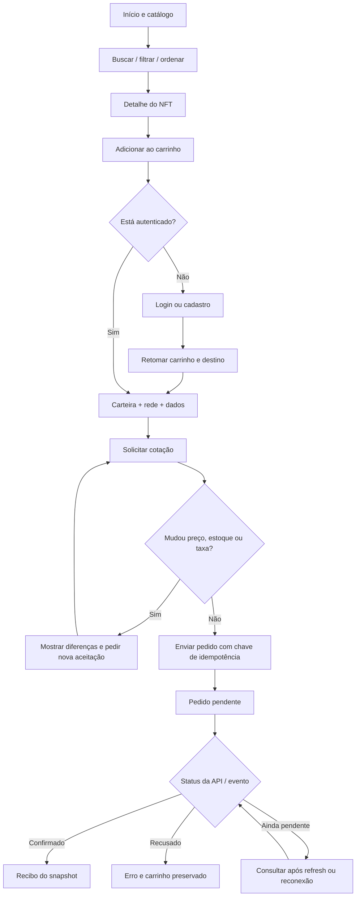
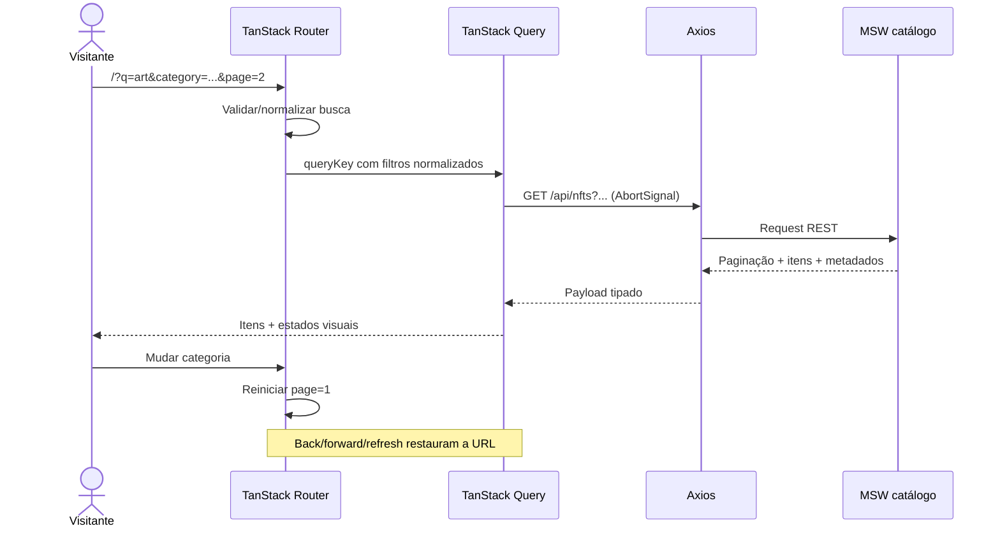
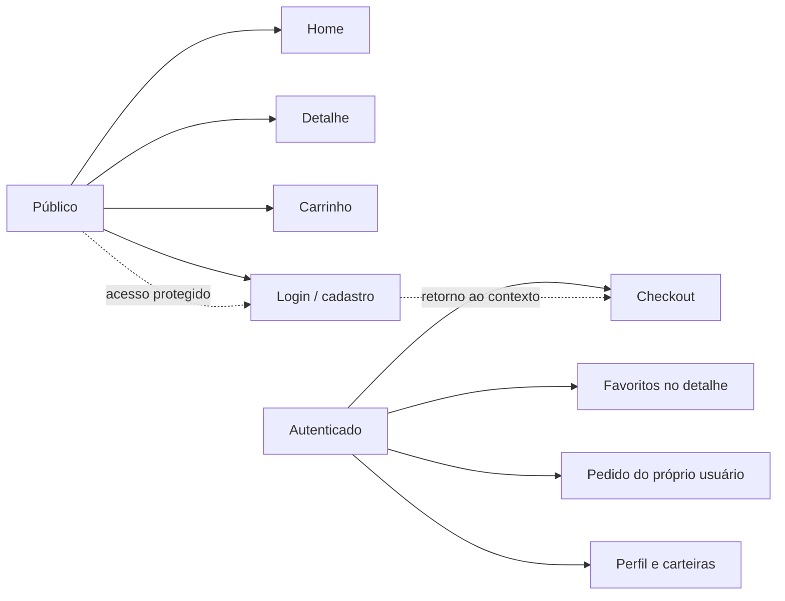

# Jornadas de usuário e navegação

## Jornada principal: descoberta até a compra

**Regra:** a página de sucesso não é um efeito visual do clique em “comprar”; exige confirmação retornada pelo mock.

## Jornada de catálogo com URL

## Navegação por acesso

## Inventário de telas exigidas

Home, detalhe, carrinho, checkout, confirmação, login, cadastro, perfil, carteiras. A interface precisa contemplar desktop e mobile, inclusive telas sem frame mobile explícito. Páginas editoriais e outros links fora do escopo não devem fingir funcionalidades.

[Índice principal](../README.md)
