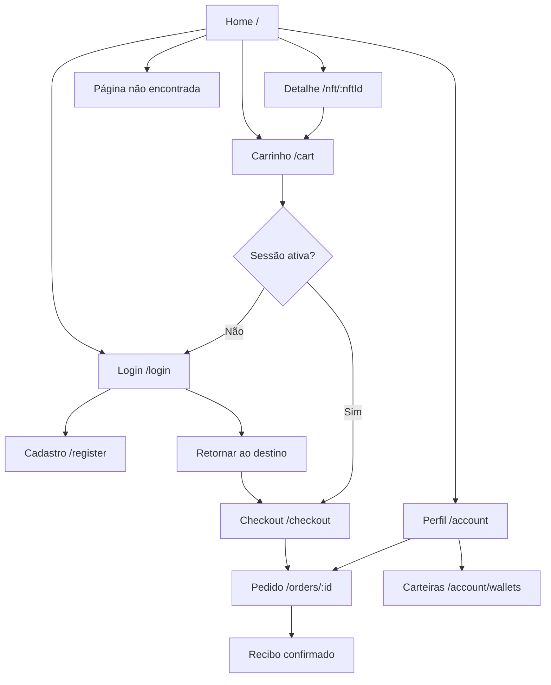

# Mapa de navegação e rotas

> As URLs são **propostas** de organização do TanStack Router. O README exige os fluxos, não esses paths exatos.

## Tabela de roteamento

| Path proposto | Acesso | URL params | Estado crítico |
|---|---|---|---|
| `/` | Público | `q`, `category`, `sort`, `page` e filtros conforme contrato | Refresh + histórico |
| `/nft/$nftId` | Público | `nftId` (path) | 404, edição indisponível |
| `/cart` | Público/conta | — | carrinho visitante e conta |
| `/checkout` | Autenticado | retorno seguro após login | cotação e sessão |
| `/orders/$orderId` | Titular | `orderId` (path) | pendente/confirmado/recusado |
| `/login` | Público | `redirect` sanitizado | validação |
| `/register` | Público | `redirect` opcional | conflito |
| `/account` | Autenticado | — | editar dados |
| `/account/wallets` | Autenticado | — | rede e principal |
| `*` | Público | — | 404 acessível |

## Invariantes de navegação

- A URL é fonte de verdade para busca, filtros, ordenação e paginação; React não mantém uma cópia divergente.
- Não permitir open redirect: `redirect` somente path local validado, não URL externa.
- Guard de rota complementa, mas **não substitui** autorização no mock backend.
- Refresh e acesso direto precisam funcionar no deploy público.

[Inventário de telas](../04-design-system/especificacao-das-telas.md) · [RF](../01-visao-geral/requisitos-funcionais.md).
