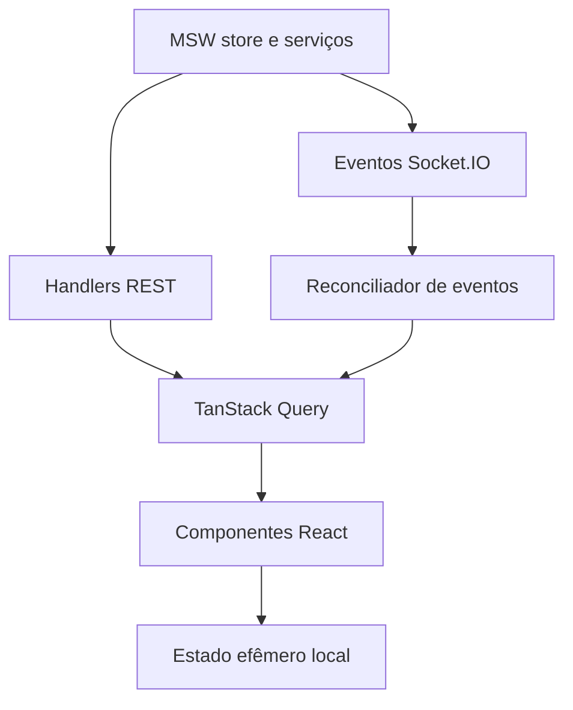

# Arquitetura e organização

A arquitetura enviada propõe uma aplicação Vite/React com TypeScript strict, organizada por domínio. Dependências fluem de `routes` para `features` e destas para `lib`/`contracts`; os mocks usam os mesmos contratos e seu próprio repositório.

```text
src/
  app/          providers, QueryClient e inicialização do worker
  routes/       rotas e proteção de acesso
  features/     catalog, auth, favorites, cart, checkout, profile, wallets, realtime
  components/  ui, layout e feedback compartilhados
  contracts/   schemas e tipos de API e eventos
  lib/          Axios, chaves de cache, dinheiro, erros e configuração
  mocks/        handlers, store, fixtures, cenários e sockets
  styles/       tokens e estilos globais
public/         worker, fontes e assets
 tests/         E2E, visual e helpers
 audits/        configuração e relatórios Lighthouse
```

> Componentes e hooks de interface não devem importar fixtures ou implementar respostas fictícias. O app interage com os mocks pela rede: Axios para REST e `socket.io-client` para eventos. O worker deve iniciar antes da primeira chamada da aplicação.

### 6.1 Fonte da verdade e cache

| Dados | Fonte de verdade | Comportamento esperado |
|---|---|---|
| Catálogo, preços, estoque | Repositório mock acessado por REST | Cache por filtros; invalidar/atualizar diante de eventos |
| Sessão e dados privados | API simulada e identidade atual | Chaves isoladas por usuário; limpeza na troca de sessão |
| Carrinho visitante/conta | Repositório simulado persistente | Associar identidade anônima e combinar na autenticação |
| Cotação | Resposta REST | Vincular a itens, preços, rede, cupom, versão e validade |
| Pedido | Repositório simulado | Consultar status por REST; eventos aceleram atualização |
| Modal e formulário | Estado local | Não duplicar sem necessidade dados remotos no React |

Configurar e documentar `staleTime`, política de invalidação e retries por tipo de operação. Retry automático de criação de pedido só é seguro com a mesma chave e payload; evitar novas tentativas com chave diferente. Cancelar consultas com `AbortSignal` onde aplicável, lidar com respostas antigas e evitar mistura de usuários. Escolher tempos concretos durante a implementação e registrá-los no `ARCHITECTURE.md` final.

[← Voltar ao índice](../README.md)

## Diagrama da fonte da verdade



**Nota:** a persistência não é o cache Query; Query reflete recursos remotos, o mock store define os resultados autoritativos. Leia [Modelo de dados](modelo-de-dados.md) e [Matriz de dependências](fluxo-de-dependencias.md).
