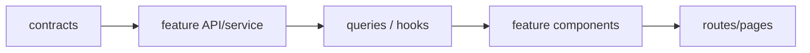

# Catálogo de módulos e contratos públicos

| Módulo | Responsabilidade | Entrada | Saída | Não deve fazer |
|---|---|---|---|---|
| `catalog` | busca, filtro, detalhes e edições | URL validada / NFT ID | `useCatalog`, `useNft` | acessar fixtures diretamente |
| `auth` | login/cadastro/sessão/logout | credenciais fictícias, rota anterior | session, identityScope | autorizar apenas via UI |
| `favorites` | favoritos por conta | userId da sessão, nftId | mutation + rollback | compartilhar chave entre contas |
| `cart` | linhas, merge e cupom | identityScope, edição, quantidade | cart + quote preview | calcular taxa verdadeira na tela |
| `checkout` | revisão, cotação e envio | carrinho, carteira, rede | quote / order id | confirmar sem revalidar |
| `orders` | consulta, status e recibo | orderId + owner | snapshot imutável | depender do preço atual do catálogo |
| `profile` | dados/avatar/senha | sessão e payload validado | perfil persistido | guardar senha em claro |
| `wallets` | carteira principal/secundária | sessão, endereço simulado, rede | wallets por dono | conectar blockchain real |
| `realtime` | eventos versionados e reconciliação | Socket.IO payloads | invalidate/refetch | aplicar payload obsoleto |
| `mocks` | REST, sockets, fixtures, store | HTTP/events/scenario | respostas coerentes | importar React |
| `contracts` | schemas de fronteira e DTOs | raw/unknown | tipos validados | importar components |
| `design` | tokens + UI genérica | protótipo via MCP do Pencil/styles | components | consultar APIs |

## Interface pública por feature

```text
features/catalog/index.ts -> useCatalog, useNft, CatalogPage
features/auth/index.ts -> useSession, useLogin, useLogout, RequireAuth
features/cart/index.ts -> useCart, useCartMutations, CartPage
features/checkout/index.ts -> useQuote, usePlaceOrder, CheckoutPage
features/orders/index.ts -> useOrder, OrderStatusPage
features/realtime/index.ts -> RealtimeProvider, attachSessionSubscriptions
```

Os nomes são **propostos**; nomes efetivos só são aceitos após implementação e ajuste desta especificação.

## Regra contra dependência circular



**Ordem do diagrama:** cada camada acima é consumida pela seguinte; componentes não importam detalhes do store simulado. Para comunicação entre features, use API pública de módulo ou uma função de orquestração de `app`, evitando ciclos.

[Dependências](fluxo-de-dependencias.md) · [Guia de código](../06-qualidade/qualidade-de-codigo.md).
