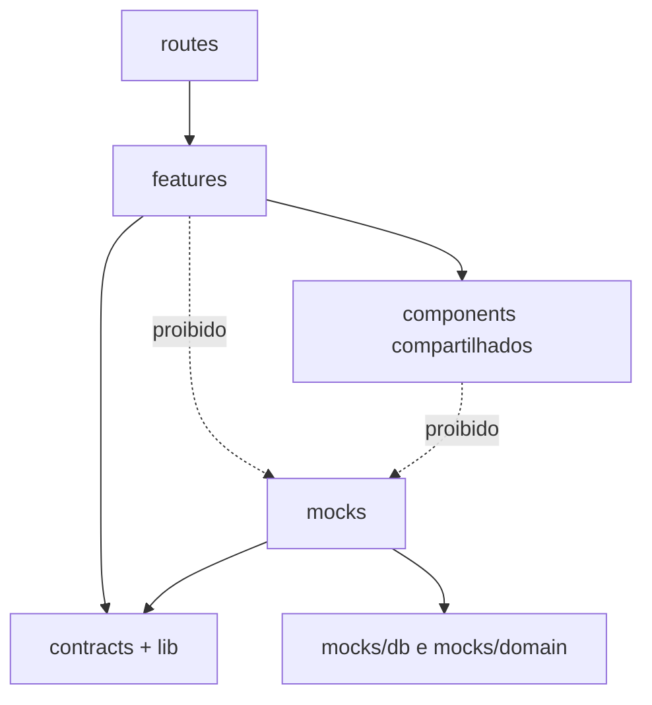

# Estrutura de diretórios — quem faz o quê

A estrutura é um **blueprint**, não uma listagem de arquivos já gerados. Cada feature agrupa API, hooks, componentes, formulários e testes de unidade quando fizer sentido.

```text
nft-marketplace/
├── README.md                   # execução real, demo, credenciais, resultados
├── ARCHITECTURE.md             # decisões e limitações verificadas
├── AGENTS.md                   # governança de agentes
├── TASKS.md                    # planejamento de implementação
├── docs/                       # documentação por assunto (esta pasta pode ser movida para docs/)
├── public/
│   ├── mockServiceWorker.js    # gerado pelo comando de inicialização do MSW
│   ├── assets/nfts/            # imagens autorizadas exportadas do protótipo via MCP do Pencil
│   ├── assets/icons/           # ícones e imagens do projeto
│   └── fonts/                  # fontes locais, conforme licença
├── src/
│   ├── main.tsx                # aguarda start do MSW antes do render
│   ├── routeTree.gen.ts        # gerado pelo plugin TanStack; não editar
│   ├── app/
│   │   ├── bootstrap.ts        # start workers, configs e errors
│   │   ├── providers.tsx       # QueryClient + RouterProvider
│   │   ├── router.ts           # instância Router + contexto
│   │   └── query-client.ts     # defaults de cache/retry
│   ├── routes/
│   │   ├── __root.tsx
│   │   ├── index.tsx
│   │   ├── nft.$nftId.tsx
│   │   ├── cart.tsx
│   │   ├── checkout.tsx
│   │   ├── orders.$orderId.tsx
│   │   ├── login.tsx
│   │   ├── register.tsx
│   │   ├── account.index.tsx
│   │   └── account.wallets.tsx
│   ├── features/
│   │   ├── catalog/{api,components,hooks,schemas}/
│   │   ├── auth/{api,components,hooks,schemas}/
│   │   ├── favorites/{api,components,hooks}/
│   │   ├── cart/{api,components,hooks}/
│   │   ├── checkout/{api,components,hooks}/
│   │   ├── orders/{api,components,hooks}/
│   │   ├── profile/{api,components,hooks}/
│   │   ├── wallets/{api,components,hooks}/
│   │   └── realtime/{client,subscriptions,reconciliation}/
│   ├── contracts/
│   │   ├── common.ts           # ApiError, Paginated, Id, Eth
│   │   ├── catalog.ts
│   │   ├── cart.ts
│   │   ├── account.ts
│   │   ├── checkout.ts
│   │   └── events.ts
│   ├── lib/
│   │   ├── http.ts             # instância Axios e interceptors
│   │   ├── query-keys.ts       # factory de chaves
│   │   ├── money.ts            # funções decimais puras
│   │   ├── errors.ts           # mapper de ApiError -> UX
│   │   └── env.ts              # flags como VITE_ENABLE_MSW
│   ├── mocks/
│   │   ├── browser.ts          # setupWorker
│   │   ├── handlers/{auth,catalog,cart,orders,profile,wallets}.ts
│   │   ├── sockets/{server,event-bus}.ts
│   │   ├── db/{adapter,repository,migrations}.ts
│   │   ├── domain/{auth,pricing,checkout,cart}.ts
│   │   ├── fixtures/{users,nfts,coupons,wallets}.ts
│   │   └── scenarios/{registry,reset,controls}.ts
│   ├── components/
│   │   ├── ui/                 # shadcn/ui customizado
│   │   ├── layout/             # navigation, header, footer
│   │   └── feedback/           # skeleton, empty, retry, error
│   └── styles/{tokens,globals}.css
├── tests/
│   ├── e2e/{catalog,auth,cart,checkout,realtime,account}.spec.ts
│   ├── visual/                 # snapshots/baselines versionados
│   ├── fixtures/               # cenários Playwright
│   └── helpers/                # reset e controle do relógio/eventos
├── audits/{config,reports}/
├── playwright.config.ts
├── vite.config.ts
├── .env.example
└── package.json
```

## Exemplo: responsabilidade de cada arquivo em `features/catalog`

| Arquivo | Deve fazer | Não deve fazer |
|---|---|---|
| `api/get-nfts.ts` | Chamar `axios.get('/api/nfts', {params, signal})` | Criar fixture |
| `hooks/use-nfts.ts` | Query key, request e estados | Duplicar catálogo em `useState` |
| `schemas/catalog-search.ts` | Validar URL e normalizar valores | Ler `localStorage` dos mocks |
| `components/nft-grid.tsx` | Renderizar cartões/loading/empty/error | Realizar regra de desconto |
| `src/mocks/handlers/catalog.ts` | Converter HTTP para serviço de domínio | Importar React |
| `src/mocks/domain/catalog.ts` | Filtrar/paginar sobre repositório e simular falhas | Atualizar componentes React |

## Roteamento

TanStack Router baseado em arquivos gera `routeTree.gen.ts`. O plugin do Router deve ser inicializado **antes do plugin React no Vite**. Arquivos de rota devem ser finos: validar params, proteger fluxo e renderizar a página da feature. Evitar regras complexas em arquivos `routes/`.

## Imports permitidos



**Não** criar um backend Node/Postgres obrigatório para a demo. Se existirem experimentos Docker, devem ficar fora do caminho padrão (`experiments/`) e não afetar `pnpm dev`/deploy.

[Mapa C4](mapa-c4.md) · [Índice](../README.md)
