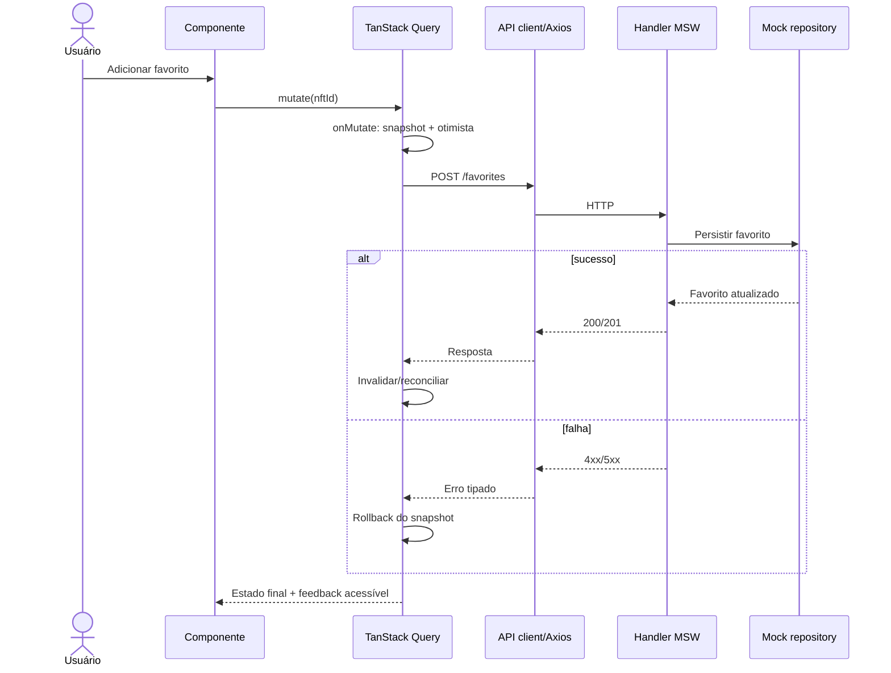

# Dependências entre módulos e fluxos de dados

## Matriz de dependências de feature

| Feature | Consome | Escreve por API | Reage a eventos |
|---|---|---|---|
| Catálogo | NFTs/edições | — | `nft.updated` |
| Detalhe | NFT específico | Favoritos / carrinho | `nft.updated` |
| Auth | Sessão | Login/cadastro/logout | Reconfigura subscriptions |
| Favoritos | Favoritos do usuário | Adiciona/remove | Restaura após falha |
| Carrinho | Linhas, disponibilidade, cotação | Inclusão/alteração/remoção | `nft.updated` invalida quote |
| Checkout | Carrinho/carteiras/quote | Cotação e pedido | `nft.updated`, `order.updated` |
| Pedidos | Pedido/recibo | — | `order.updated` |
| Perfil/carteiras | Recursos privados | Edição | Cleanup ao trocar sessão |

## Fluxo de uma mutation

## Fluxo de consulta com cancelamento

`Route.search` → normalização → chave Query com todos os filtros → `axios({params, signal})` → MSW filtra dados → resposta. Quando filtros mudam, a consulta antiga é abortada ou seu resultado não deve sobrescrever a consulta atual.

## Estratégia de dependências cíclicas

- `contracts/` não importa `features/` nem `mocks/`.
- `mocks/domain/` pode importar `contracts/` e `mocks/db/`, não React.
- `features/checkout` não deve importar implementações privadas de `features/cart`; usar APIs/contratos compartilhados ou interfaces explícitas.
- `query-keys` não pode depender de hooks React.
- Não cruzar diretamente entidades privadas entre `features/auth` e `features/realtime`: expor uma função controlada de `attachSession`/`detachSession` ou event dispatcher de app.

[Índice principal](../README.md)
