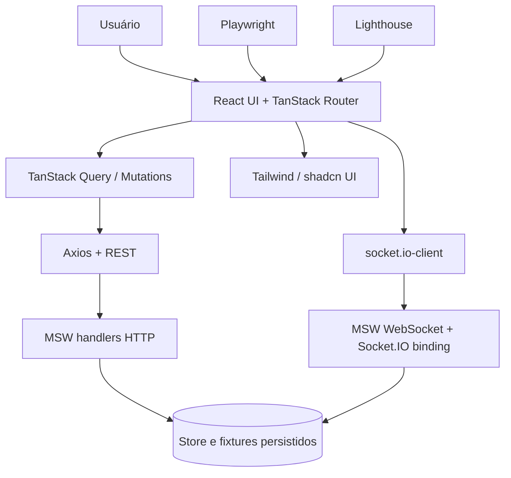
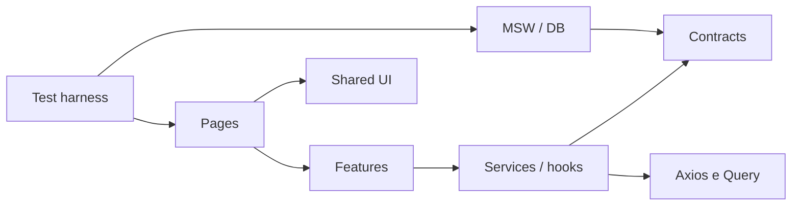

# Limites arquiteturais, dependências e responsabilidades

## Contexto / containers

## Regras de dependência

- `routes` importam `features` e `components`; nunca repositório mock diretamente.
- `features` importam `contracts`, `lib`, `components`, hooks das próprias features; dependências cruzadas precisam interface pública.
- `lib/http` configura Axios e tratamento de erro; não contém fixtures.
- `mocks` implementa infraestrutura/test data; depende de `contracts`; não depende de código React.
- `realtime` traduz payload versionado em invalidação/reconciliação; não decide negócio de checkout sozinho.
- `tests` observam comportamento pela UI, REST via MSW e protocolo Socket.IO; não devem induzir resultado via setters de componente.

## Classificação de estado

| Estado | Dono | Fonte de verdade |
|---|---|---|
| Filtros/página/ordenar | Router | URL validada |
| Modal, aba, foco, seleção temporária | React local | Componente |
| NFTs, favoritos, carrinho, perfil, pedidos | TanStack Query | API simulada |
| Cotação e pedido | MSW/store | API, com snapshot/version |
| Evento realtime | Socket.IO | Notificação; REST reconcilia |
| Identidade da sessão | Auth feature / API | Sessão no store MSW |

## Direção de dependências

**Antipadrões proibidos:** componente `import { fixtures } from 'mocks'`; `setTimeout` para simular `order.updated` na UI; múltiplas fontes de preço; mutation de pedido com retry sem idempotência.

[Mapa C4](mapa-c4.md) · [Estrutura de pastas](estrutura-de-pastas.md) · [Estado](modelo-de-estado.md).
