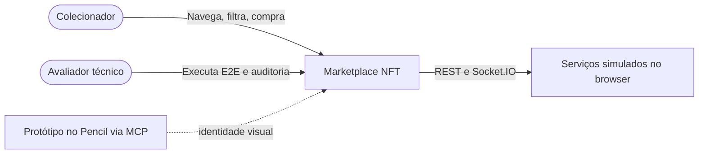
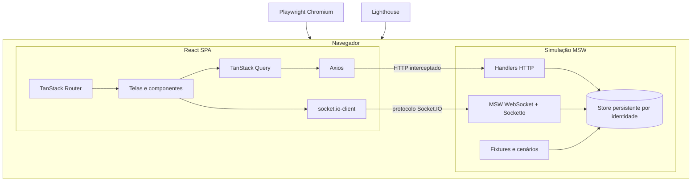
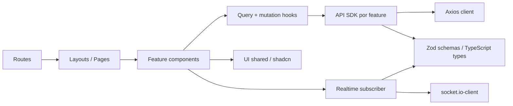

# Mapa C4 — Contexto, containers e limites

Os diagramas a seguir usam o **vocabulário C4**, simplificado em Mermaid. São **propostas** de organização, não uma descrição de serviços existentes da empresa.

## Nível 1: contexto

- **Colecionador** executa o fluxo de descoberta, conta, compra e acompanhamento.
- **Avaliador** executa testes, cenários, medições e navegação direta.
- **Simulação** substitui serviços reais de blockchain, carteira e pagamento; o produto continua acessível sem backend privado.

## Nível 2: containers

**Crítico:** o navegador e o MSW podem compartilhar o mesmo ambiente de execução, mas a **fronteira de comunicação** deve continuar sendo HTTP/WebSocket. Nunca importar `mocks/db` diretamente da UI. A persistência proposta deve resistir ao refresh e aceitar reset previsível.

## Nível 3: componentes (limite do frontend)

## Onde ficam as regras?

| Regra | Local |
|---|---|
| Validação e contrato HTTP | `src/contracts/`, e verificação de fronteira em handlers/clients |
| Regra de total/cupom/estoque | `src/mocks/domain/` ou serviço de domínio do mock |
| Autenticação/isolamento | `src/mocks/domain/auth` e `src/features/auth` para consumo |
| Ordenação/filtros do catálogo | handler REST e URL/search schema |
| Apresentação visual | `src/features/*/components`, `src/components/ui` e `styles` |
| Estados efêmeros de dialog/form | componentes/hooks locais |
| Cache e invalidação | hooks `features` + `lib/query-keys.ts` |

[Próximo: pastas](estrutura-de-pastas.md) · [Índice](../README.md)
