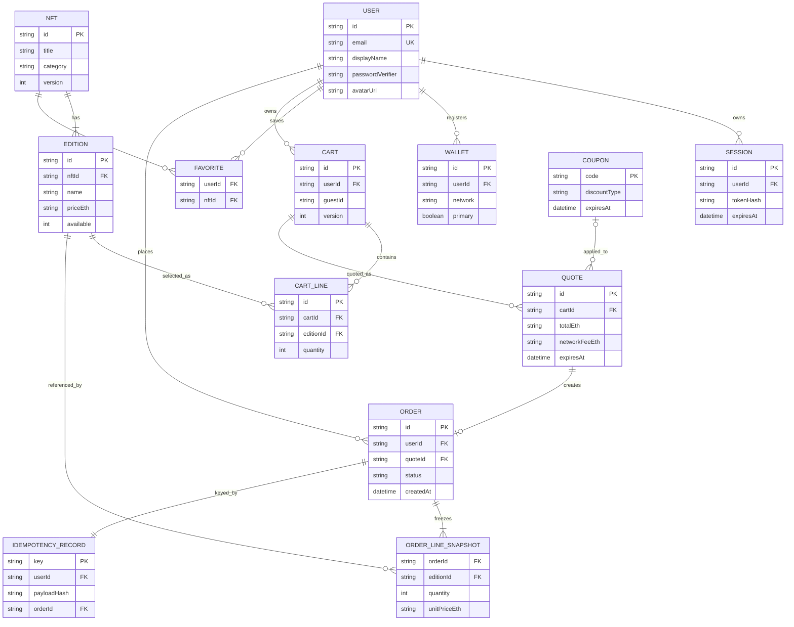

# Modelo de dados — domínio e relacionamentos

**Status:** modelo lógico proposto para a API simulada; não é esquema PostgreSQL exigido. A persistência sugerida é baseada em adaptador local (p.ex. IndexedDB). Os vínculos são conceituais e devem ser preservados pelos handlers.

## Diagrama entidade-relacionamento (ERD)

## Entidades e invariantes

| Entidade | Campos críticos | Restrições |
|---|---|---|
| `User` | `id`, `email`, `passwordVerifier`, perfil | e-mail único e dados fictícios; sem senha em claro |
| `NFT` | `id`, `category`, `images`, `version` | versão monotônica para eventos |
| `Edition` | `id`, `nftId`, `available`, `priceEth` | `available >= 0`; preço decimal como string |
| `Favorite` | `userId`, `nftId` | par único; proprietário obrigatório |
| `Cart` | `userId` **ou** `guestId`, `version` | exatamente uma identidade; persistente |
| `CartLine` | `editionId`, `quantity` | inteiro positivo; respeita limite de estoque |
| `Quote` | snapshot de linhas/taxas/cupom, `expiresAt`, `version` | total API autoritativo, validade explícita |
| `Order` | `status`, `userId`, `quoteSnapshot`, `idempotencyKey` | terminal não regride; snapshot imutável |
| `IdempotencyRecord` | `(userId,key)`, `payloadHash`, `orderId` | mesma tentativa → mesmo pedido; conteúdo diferente → conflito |
| `Wallet` | `userId`, `network`, `isPrimary` | conta somente usa suas carteiras |

## Decisão importante: anonimato do carrinho

Um `guestId` persistente do navegador identifica o carrinho antes do login. Após autenticação, o servidor simulado combina as linhas do visitante com as do usuário. **Proposta de regra:** somar quantidades por `(nftId,editionId)`, limitar ao estoque disponível e retornar conflitos explicando cortes, sem perder silenciosamente itens. O comportamento exato precisa ser fechado e testado.

## Confiabilidade transacional

O mock store precisa de operação atômica para criação de pedido + registro idempotente + reserva/desconto de disponibilidade na confirmação. Duas chamadas concorrentes não podem criar compras duplicadas; uma gravação durável não pode ser seguida por um timeout que gere novo pedido com chave diferente.

## Dados que NÃO devem ir para o recibo por referência mutável

Preço atual do NFT, estoque atual, nome editável do perfil e versão atual do catálogo. O recibo deve conter cópias dos valores consolidados, da rede e das referências simuladas no momento do pedido.

[Índice principal](../README.md)
