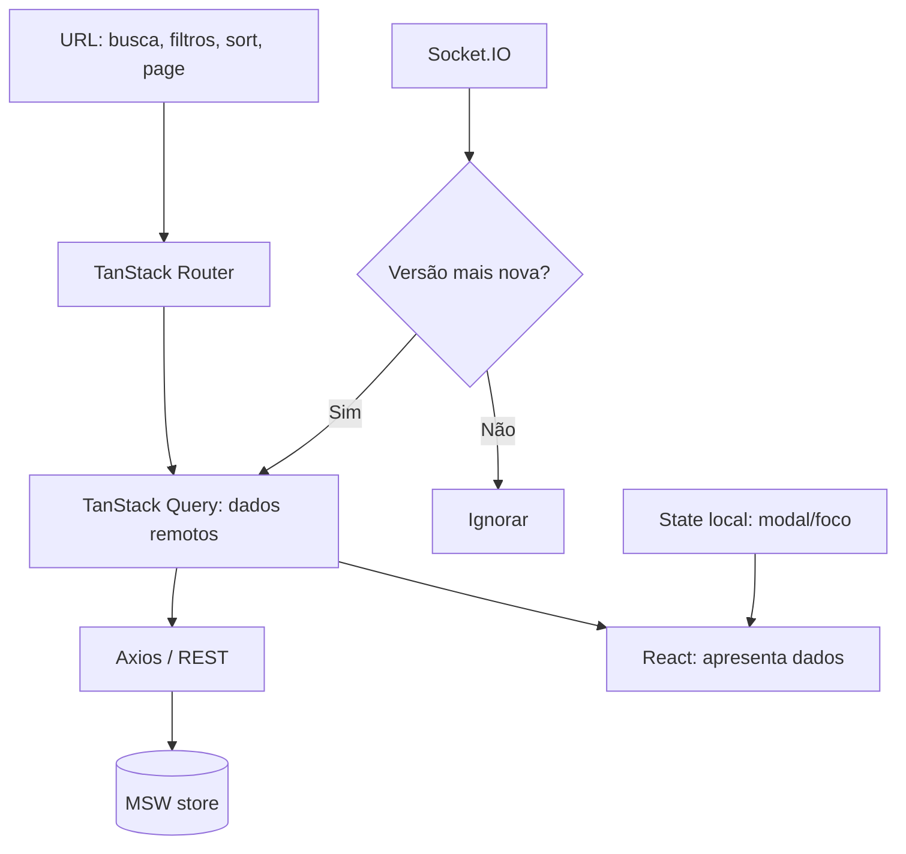
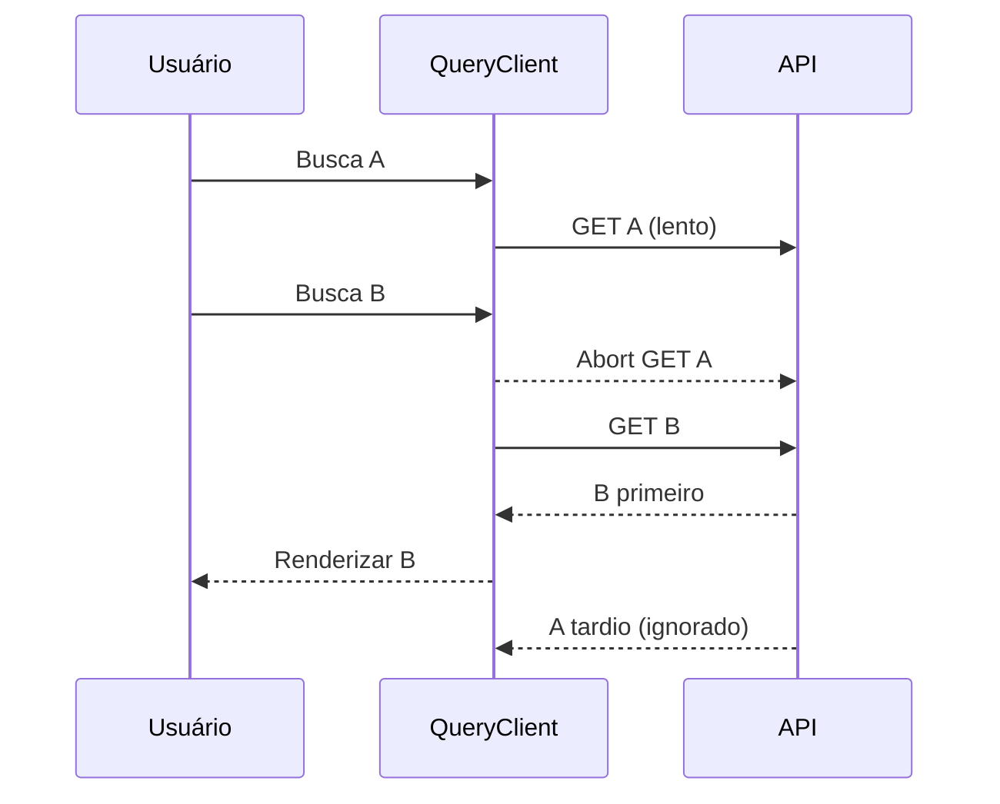

# Modelo de estado — UI, URL, cache, sessão e tempo real

## Responsabilidade de cada armazenamento



## Query keys — formato proposto

```ts
// Exemplo de schema de identidade (não código implementado)
const keys = {
  catalog: (search: CatalogSearch) => ['catalog', search] as const,
  nft: (id: string) => ['nft', id] as const,
  cart: (scope: string) => ['cart', scope] as const,
  favorites: (scope: string) => ['favorites', scope] as const,
  wallets: (scope: string) => ['wallets', scope] as const,
  order: (scope: string, id: string) => ['orders', scope, id] as const,
};
```

## Consistência, retries e cancelamento

1. Parâmetros normalizados fazem parte da query key; URL e cache usam o mesmo contrato.
2. `AbortSignal` do TanStack Query deve ser passado ao Axios; descartar resposta obsoleta.
3. `staleTime/retry` devem ser documentados por tipo de recurso (catálogo x pedido); `POST /orders` **não** tem retry cego.
4. Atualização otimista somente onde reversível, como favoritos; cancelar consulta, snapshot do cache, rollback e invalidação final.
5. `nft.updated` e `order.updated` precisam versão; eventos no mesmo recurso com version menor/igual são descartados.
6. Reconexão não sincroniza só por evento; usa REST para reconstruir estado autoritativo.
7. Logout troca `sessionEpoch`, cancela consultas privadas e remove dados cacheados antes de ativar próxima sessão.

## Cenário de corrida (prevenir)



[Regras](../01-visao-geral/regras-de-negocio.md) · [API](../05-integracoes/especificacao-de-contratos.md) · [Tempo real](../05-integracoes/tempo-real.md).
