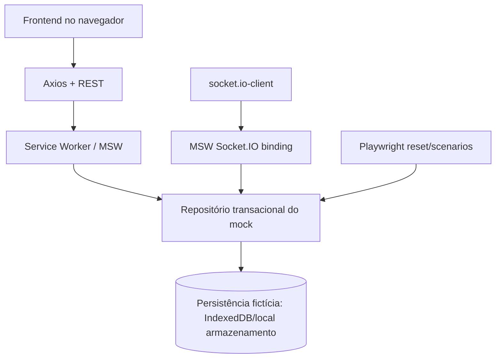

# Estratégia de persistência e fronteiras da simulação

## Decisão proposta

O README exige **MSW com estado coerente e suporte a refresh**, e deploy público independente de backend privado. Para esse teste, não adicionar PostgreSQL/Docker como dependência de execução: acrescentaria serviço, deploy e sincronização desnecessários. Se desejado, Docker/PostgreSQL pode ser um laboratório opcional posterior, nunca fonte de dados exclusiva do build público.

## Objetos a persistir

| Objeto | Escopo | Estratégia sugerida |
|---|---|---|
| NFTs/edições/versões | Global ao cenário | fixtures com atualizações persistentes |
| Sessões | Identidade + TTL | store mock com token fictício e expiração |
| Carrinho visitante | guestId | persistência local própria |
| Carrinho autenticado | userId | escopo de usuário |
| Favoritos/perfil/carteiras | userId | dados privados no mock |
| Cotação | userId + cartVersion + TTL | temporária, sempre revalidada |
| Pedido/idempotency key | userId + tentativa | snapshot imutável, versão e status |
| Cenários de teste | scenarioId + seed | reset previsível |

## Invariantes de persistência

- Atualizações precisam ocorrer transacionalmente no repositório de domínio (mock); não em vários estados não coordenados.
- Reset remove todos os efeitos e recria as fixtures para o cenário selecionado.
- Tratar estrutura do banco simulado como contrato de implementação, sem prometer segurança equivalente a backend real.
- Tokens fictícios, endereços e contas sintéticas; não armazenar segredos ou senha em claro no browser.

## Alternativa de banco real (fora do caminho crítico)

Uma variante Node.js + Prisma + PostgreSQL poderia ser acoplada por um contrato HTTP compatível, mas precisaria implantar o backend para demo e não atende sozinha ao requisito MSW. Não planejar até cumprir os critérios eliminatórios.

[ADR](decisoes-arquiteturais.md) · [Segurança](../06-qualidade/seguranca-aplicacional.md).
