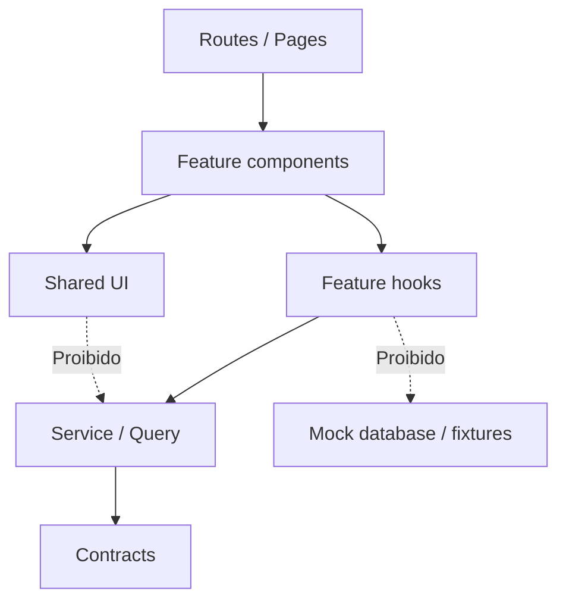

# Contrato de componentes e composição

## Camadas permitidas



- `components/ui`: componentes atômicos shadcn/ui customizados; sem fetch, sem regra de negócio.
- `components/layout`: AppShell, Header, Footer, containers; sem estado de domínio.
- `features/*/components`: UI de domínio que recebe props específicas e interage por hooks de feature.
- `features/*/queries|mutations|api`: integrações remotas e query keys, nunca importadas em `components/ui`.
- `contracts`: DTOs/schemas e erros comuns; sem dependência de React.

## Convenção de API de componente

```ts
// Exemplo ilustrativo, não código implementado.
type NftCardProps = {
  nft: NftSummary;
  isFavorite: boolean;
  onToggleFavorite: (nftId: string) => void;
};
```

**Qualidade:** props explícitas, sem `any`; estado local só para controle visual; não armazenar toda a resposta remota em state. Componentes interativos precisam label/acessibilidade e estado disabled/loading.

## Checklist para novo componente

- [ ] Nome expressa responsabilidade; está na pasta certa.
- [ ] Tipos públicos estáveis e sem acoplamento a MSW.
- [ ] Estados loading/empty/error definidos quando recebem dados.
- [ ] Estilos usam tokens e seguem o protótipo inspecionado pelo MCP do Pencil; alterações são justificadas.
- [ ] Responde a teclado, foco e zoom.
- [ ] Teste de comportamento relevante e captura visual quando crítico.

[Code style](../06-qualidade/qualidade-de-codigo.md) · [Acessibilidade](../06-qualidade/acessibilidade.md).
