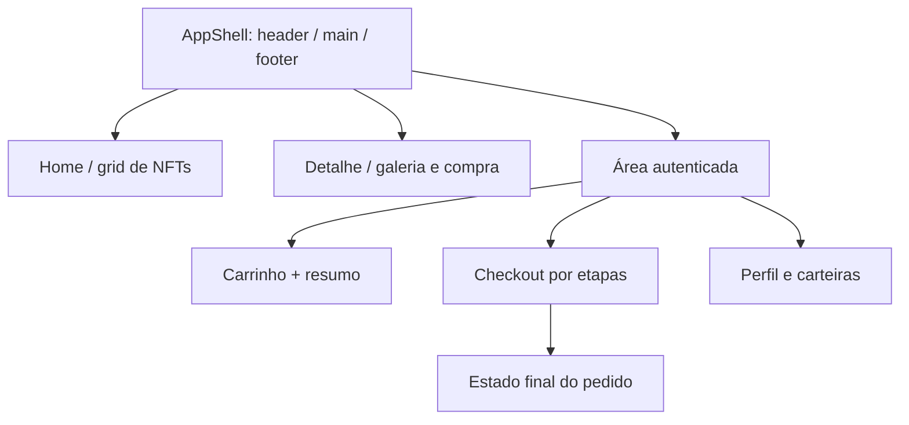

# Especificação das nove telas e seus estados

> Referência para inspeção visual: protótipo do projeto no Pencil (pen.dev), acessado pela conexão MCP. A correspondência com a referência oficial ainda deve ser validada; não utilizar o Figma para visualizar o protótipo. Valores de cor, família tipográfica e assets devem ser copiados da fonte inspecionada, **não inventados**. Abaixo está o comportamento exigido.

| Tela | Componentes esperados | Estados de interação | RF |
|---|---|---|---|
| **Home** | Hero/destaques, busca, filtros, sort, grid, paginação | skeleton, empty, error, loading em segundo plano | 001–008, 050–053 |
| **Detalhe** | Galeria, metadados, edição, estoque, quantidade, favorito, adicionar | 404, esgotado, limite, preço atualizado | 009–011, 023, 030 |
| **Carrinho** | Linhas, contador, cupom, resumo, checkout CTA | vazio, atualizar quantidade, erro de estoque, skeleton | 024–030 |
| **Pagamento** | Dados, seleção de rede/carteira, cotação, revisão, CTA | validação, recusa, preço alterado, timeout, pending | 031–037 |
| **Confirmação** | Resumo do pedido, id/referência, taxas e total | confirmed, declined e pending com telas distintas | 038–042 |
| **Login** | Identificação, senha, feedback e caminho de cadastro | inválido, loading, sessão expirada, redirect | 012–017 |
| **Cadastro** | Campos, confirmação e feedback | validação, conflito 409, sucesso | 012 |
| **Perfil** | Dados, avatar, alteração de senha, salvar | loading, validação, sucesso e falha | 018–019 |
| **Carteiras** | Principal/secundária, criação/edição, rede | ausência, conflito, erro de formulário | 020–021 |

## Diagrama de hierarquia visual (esquemático, não é o protótipo)

## Matriz de QA responsivo

- **390px:** header compacto, filtros acessíveis em drawer, ações com toque, formulário sem scroll horizontal.
- **768px:** layout intermediário, conteúdo não corta tabelas e cartões, foco/menus funcionais.
- **1440px:** aproximação estrita dos frames desktop, proporções coerentes e densidade de conteúdo apropriada.
- **Zoom:** 200% sem perda de conteúdo ou funcionalidade.
- **Acessibilidade:** navegação por tab, foco em modal, títulos hierárquicos, mensagens de erro ligadas a campo, `aria-live` para resultados assíncronos.

## Protocolo de inspeção do protótipo via MCP do Pencil

1. Inventariar frames por nome, largura, versão e variações (mobile/desktop).
2. Exportar assets/imagens/fontes quando permitidos; manter caminhos locais reproduzíveis.
3. Mapear componentes shadcn/ui necessários e suas alterações de tokens.
4. Criar screenshot de referência por tela/viewport com dados estáveis.
5. Documentar diferenças necessárias para acessibilidade e estados não desenhados.

[Design tokens](tokens-e-componentes.md) · [Inventário de assets](inventario-figma.md) · [NFR](../01-visao-geral/requisitos-nao-funcionais.md).
