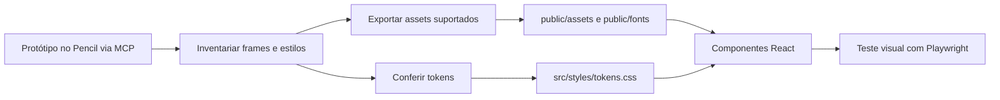

# Inventário do protótipo no Pencil, componentes e assets

**Fonte para inspeção visual:** protótipo do projeto no Pencil (pen.dev), acessado pela conexão MCP. **[VALIDAR]** A disponibilidade do protótipo, sua correspondência com a referência oficial e os frames e assets ainda não foram verificados nesta revisão. Os nomes abaixo são **funcionais**, não alegações de nomes reais dos frames.

## O que extrair do protótipo pelo MCP do Pencil

1. Identificar frames **desktop e mobile** das nove telas exigidas.
2. Registrar dimensões, tipografia, peso, line-height, espaçamento, alinhamento e radius de cada componente.
3. Exportar imagens de NFT, logotipos, ícones, ilustrações e fontes (observando licenças).
4. Associar frame → componente React → rota → teste visual.
5. Conferir os estados que não existem no protótipo e desenhá-los coerentemente: skeleton, vazio, erro, confirmação, recusa, validação, sessão expirada.

## Checklist de inventário

| Tela funcional | Desktop | Mobile | Assets a conferir | Componente proposto |
|---|---|---|---|---|
| Home/catálogo | VALIDAR | VALIDAR | hero, cards, filtros | `CatalogPage` |
| Detalhe | VALIDAR | VALIDAR | galeria, thumb, ícones | `NftDetailPage` |
| Carrinho | VALIDAR | VALIDAR | cards, resumo | `CartPage` |
| Checkout | VALIDAR | VALIDAR | carteira/rede, formulários | `CheckoutPage` |
| Confirmação | VALIDAR | Derivar padrão | estado/pedido | `OrderPage` |
| Login | VALIDAR | VALIDAR | logo/ilustração | `LoginPage` |
| Cadastro | VALIDAR | VALIDAR | logo/ilustração | `RegisterPage` |
| Perfil | VALIDAR | Derivar padrão | avatar/form | `AccountPage` |
| Carteiras | VALIDAR | Derivar padrão | redes/ícones | `WalletsPage` |

## Fluxo de integração dos assets

## Sobre os tokens já transcritos

A documentação anterior menciona Roboto Mono, escala 4–64 px e paleta marrom/creme/laranja, derivadas de um PDF de design system fornecido anteriormente. Esses valores foram **preservados** em [tokens-e-componentes.md](tokens-e-componentes.md), mas devem ser confrontados com o protótipo inspecionado pelo MCP do Pencil. Não extrapolar valores faltantes como se fossem oficiais.

## Critérios práticos

- Usar dimensões explícitas de imagens para reduzir CLS.
- `alt` descritivo em imagens informativas; decorativas `alt=""`.
- Não usar screenshots achatadas como substituto de uma tela interativa.
- Registrar substituições de assets e diferenças deliberadas de acessibilidade no documento final.

[Índice principal](../README.md)
