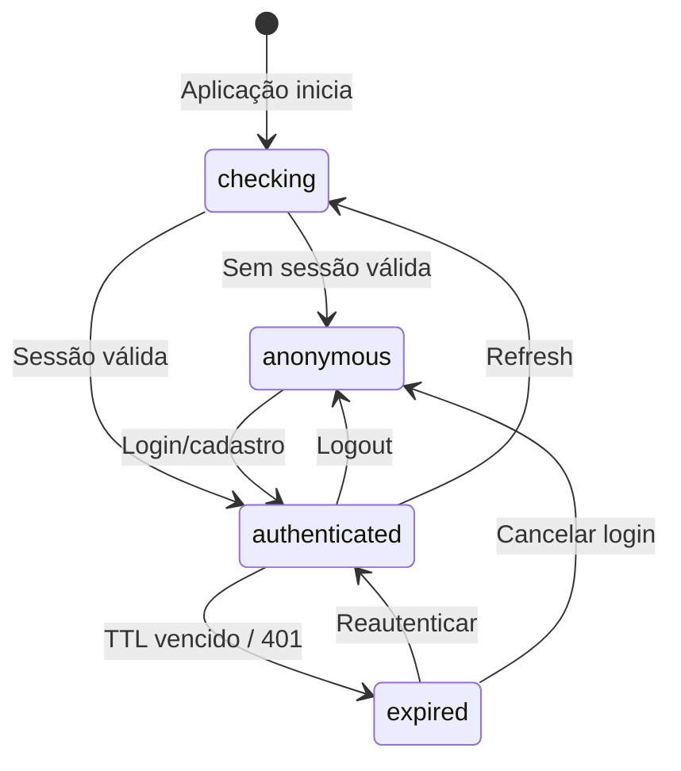
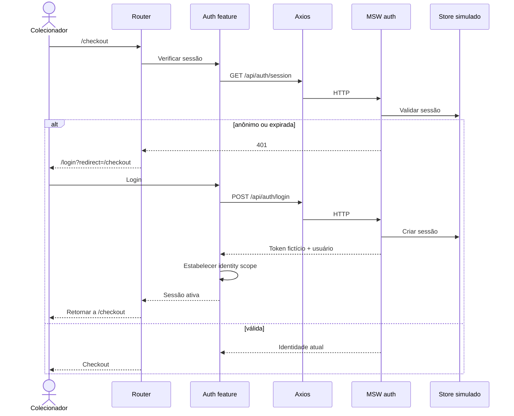

# Autenticação, sessão e isolamento por usuário

**[EXIGIDO]** Cadastro, login, logout, sessão recuperável após refresh, expiração inclusive em checkout, isolamento de dados, persistência de perfil/carteiras e validações.

## Estados de sessão



## Sequência de acesso protegido e retorno



## Teardown de sessão — ordem recomendada

1. Bloquear mutações privadas novas e invalidar identity scope anterior.
2. Cancelar queries privadas em andamento via QueryClient e `AbortSignal`.
3. Desconectar `socket.io-client`, liberar listeners, subscrições e callbacks.
4. Remover ou limpar queries privadas, inclusive perfil, favoritos, carrinho e pedidos.
5. Invalidar credencial simulada e estabelecer nova identidade (ou anônimo).
6. Reconsultar o carrinho adequado e sincronizar subscriptions da nova sessão.

Um token de demonstração armazenado pelo cliente **não equivale a autenticação segura para produção**. Evitar senha em claro mesmo nas fixtures; se o armazenamento de credencial for necessário, usar verificador fictício/derivado e documentar o modelo de ameaça reduzido.

## Cache privado: factory proposta

```ts
const queryKeys = {
  nfts: (params: unknown) => ['nfts', params] as const,
  nft: (id: string) => ['nft', id] as const,
  favorites: (userId: string) => ['user', userId, 'favorites'] as const,
  cart: (identityKey: string) => ['cart', identityKey] as const,
  order: (userId: string, orderId: string) => ['user', userId, 'order', orderId] as const,
  profile: (userId: string) => ['user', userId, 'profile'] as const,
};
```

**Atenção:** query key isolada é condição necessária, não suficiente. Sem limpeza e cancelamento, resposta tardia da sessão A pode ainda vazar no estado de UI da conta B. Proteger também os commits de requests com um `sessionEpoch`/identificador de sessão.

## Expiração durante checkout

Salvar contexto **não sensível** para retomar (rota, linha do carrinho, `quoteId` apenas para revalidar). Nunca reusar cotação expirada sem checagem. Após novo login, reconsultar carrinho/carteiras/quote e pedir nova confirmação quando necessário.

[Testes](../06-qualidade/testes.md) · [Índice](../README.md)
