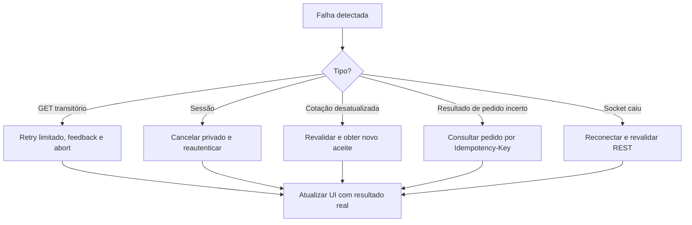

# Catálogo de falhas, mensagens e recuperação

O teste cobra estados vazios, latência, timeouts, erros HTTP e respostas fora de ordem. Cada condição precisa de comportamento observável.

| Cenário | Origem | Resposta de UI | Recuperação / teste |
|---|---|---|---|
| Catálogo vazio | `GET /nfts` vazio | Empty state, limpar filtros | E2E aplicando filtros impossíveis |
| Catálogo lento | MSW delay | Skeleton shimmer com dimensões | E2E controle de tempo |
| Fetch antigo termina depois | Latência variável | Não sobrescrever filtros atuais | E2E troca rápida de filtro |
| NFT inexistente | `404 NOT_FOUND` | NotFound contextual | E2E deep link |
| Sessão expirada | `401 SESSION_EXPIRED` | Solicitar login, preservar destino | E2E checkout + expiração |
| Acesso a pedido alheio | `403 FORBIDDEN` | Sem dados privados | E2E usuários A/B |
| Cupom expirado | `COUPON_EXPIRED` | Mensagem junto ao campo | E2E cupom expirado |
| Preço/estoque alterado | `409 QUOTE_STALE` ou evento | Diferença explícita, bloquear confirmar | E2E com socket |
| Pedido pós-timeout | timeout de rede | “Verificando compra”; manter chave | E2E recuperar por chave |
| Pagamento recusado | `order.updated` / GET | Estado recusado, preservar carrinho | E2E recusa |
| Socket desconectado | transporte | Banner discreto, reconsultar após voltar | E2E reconexão |
| Evento antigo | `version` anterior | Ignorar sem retroceder status | E2E duplicata e reordenação |
| Falha ao favoritar | Mutation 5xx | Rollback e toast acessível | E2E rollback |

## Convenções de feedback

- Erro de formulário associado ao input via `aria-describedby`.
- Alterações assíncronas via região `aria-live` adequada.
- Não exibir `Error: [object Object]`, stack trace, token ou dados privados.
- Oferecer “Tentar novamente” somente se a operação for segura; pedidos devem recuperar a tentativa por chave antes de reenviar.

## Ordem de recuperação de estado remoto

[Índice principal](../README.md)
