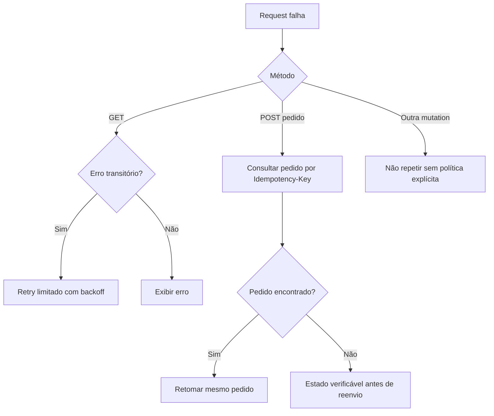

# Política de erros e repetição de operações

## Envelope de erro (proposta)

```ts
interface ApiErrorResponse {
  error: {
    code: string;          // ex.: QUOTE_STALE
    message: string;       // texto para exibição
    details?: Record<string, unknown>;
    requestId?: string;    // identificador fictício
  };
}
```

## Matriz por categoria

| HTTP/estado | Semântica | Comportamento de cliente |
|---|---|---|
| 400/422 | Entrada inválida | Anexar a campos e preservar form |
| 401 | Sessão ausente/expirada | Limpar identidade/cache; login e retorno seguro |
| 403 | Outro dono/permissão | Negar sem revelar dados privados |
| 404 | Recurso ausente | Página amigável e link para retorno |
| 409 | Conflito estoque/quote/idempotência | Reconsultar, comunicar diferença e reconfirmar |
| 410/422 | Cupom expirado/inválido | Remover desconto da UI; permitir ajuste |
| 5xx / offline | Falha temporária | Retry seguro para GET, feedback para mutation |
| Timeout após pedido | Resultado desconhecido | Consultar pela mesma chave antes de novo POST |

## Pseudopolítica de retries



## Falhas em cascata

Nenhum erro de um recurso deve cancelar sessão inteira, exceto 401 autenticado. Eventos de websocket não substituem REST e não invalidam de forma ilimitada. Tratamento de backoff e retries deve ser parametrizado para testes determinísticos.

[Catálogo de códigos](catalogo-de-erros.md) · [Recuperação](../02-produto/fluxos/erros-e-recuperacao.md).
