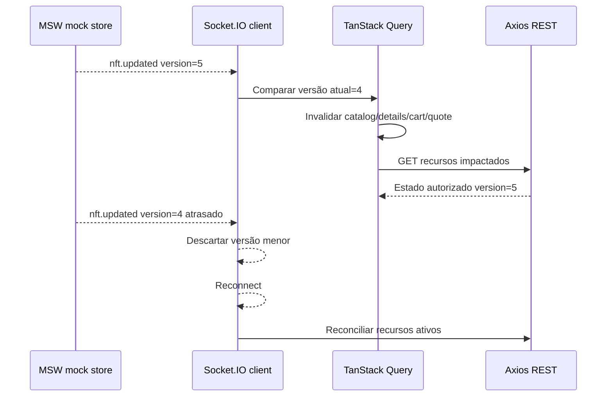

# Catálogo de eventos Socket.IO — contratos e ordenação

> **Eventos exigidos:** `nft.updated` e `order.updated`; a forma de payload abaixo é **proposta** para garantir identidade, versão e escopo. O README não fixa os nomes dos campos.

## nft.updated

```json
{
  "eventId": "evt-nft-101",
  "type": "nft.updated",
  "resourceId": "nft-001",
  "editionId": "ed-001",
  "version": 5,
  "changedAt": "2026-11-05T10:00:00Z",
  "changes": {"priceEth": "0.150", "available": 2}
}
```

## order.updated

```json
{
  "eventId": "evt-order-202",
  "type": "order.updated",
  "resourceId": "order-001",
  "ownerScope": "user-001",
  "version": 3,
  "changedAt": "2026-11-05T10:00:30Z",
  "changes": {"status": "confirmed"}
}
```

Identificadores, campos e datas acima são **ilustrativos e fictícios**, não API real.

## Sequência e reconciliação



## Regras de processamento

- `eventId` permite rastrear duplicatas; `version` evita retrocesso mesmo em reordenação.
- Para pedido, verificar `ownerScope`/`sessionEpoch` antes de aplicar resultado privado.
- `confirmed` e `declined` não transicionam para outro status, mesmo com evento reordenado.
- Evento informa mudança; REST é fonte final para detalhes em caso de dúvida.
- Listener ligado à sessão/feature deve ser removido no cleanup e na troca de conta.
- MSW e Socket.IO compartilham o mesmo repositório simulado; não haver “duas bases” de dados.

## Limitações técnicas verificáveis

O [binding oficial](https://github.com/mswjs/socket.io-binding) suporta namespace padrão e eventos textuais; namespaces customizados, acknowledgements e anexos binários não são suportados. Provar integração com `socket.io-client` no spike.

[Tempo real](tempo-real.md) · [Estados](maquinas-de-estado.md) · [Spike](../07-planejamento/spikes-e-dependencias.md).
