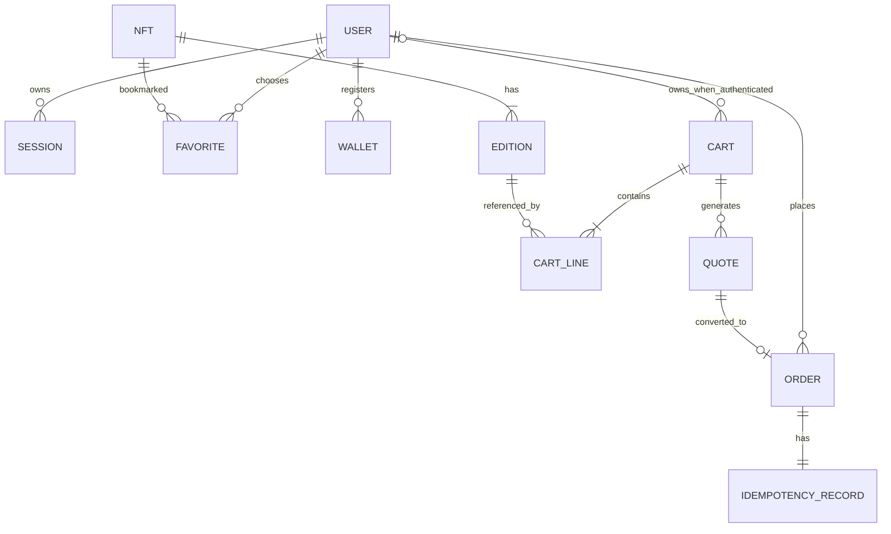

# Dicionário de dados e identificadores de domínio

> Modelo lógico **proposto** para mock REST. O README exige os recursos, mas não determina nomes exatos dos campos. Usar os mesmos tipos no repositório, schemas e camada de API.

## Entidades

| Entidade | Chave | Campos principais (propostos) | Restrições |
|---|---|---|---|
| `User` | `userId` | name, email, avatarUrl, passwordVerifier | e-mail único; nunca senha em claro |
| `Session` | `sessionId` | userId, issuedAt, expiresAt, active | token/ID fictício, expiração |
| `Nft` | `nftId` | name, description, images, category, version | version monotônica |
| `Edition` | `editionId` | nftId, name, priceEth, available | preço decimal string; estoque ≥ 0 |
| `Favorite` | `userId + nftId` | createdAt | somente proprietário |
| `Cart` | `cartId` | ownerScope, version, couponCode | escopo visitante ou autenticado |
| `CartLine` | `lineId` | nftId, editionId, quantity | inteiro > 0; edição válida |
| `Quote` | `quoteId` | userId, cartVersion, network, totals, expiresAt | autoridade temporária, total decimal |
| `Order` | `orderId` | userId, quoteSnapshot, status, version | status terminal irreversível |
| `IdempotencyRecord` | `userId + key` | requestHash, orderId, createdAt | mesma chave+payload → mesmo pedido |
| `Wallet` | `walletId` | userId, label, network, address, isPrimary | proprietário; endereço fictício |
| `Scenario` | `scenarioId` | seed, networkLatency, failureMode | reprodução/reset determinísticos |

## Relações — ERD

## Invariantes de dados

- `version`: inteiro monotônico; evento usa versão da mesma entidade.
- `priceEth`, `subtotalEth`, `discountEth`, `networkFeeEth`, `totalEth`: strings decimais, nunca IEEE float para regra monetária.
- `available`: estoque não pode ficar negativo; edições esgotadas não permitem compra.
- `order.quoteSnapshot`: cópia imutável da cotação, itens e referências no instante da compra.
- `cart.ownerScope`: identidade **exclusiva** de convidado ou usuário; merge é operação explícita.
- `sessionId/token`: não embutir PII ou segredo real; demonstrativo.

[Modelo lógico anterior](../03-arquitetura/modelo-de-dados.md) · [Contratos](especificacao-de-contratos.md) · [Persistência](../03-arquitetura/persistencia-e-fronteiras.md).
