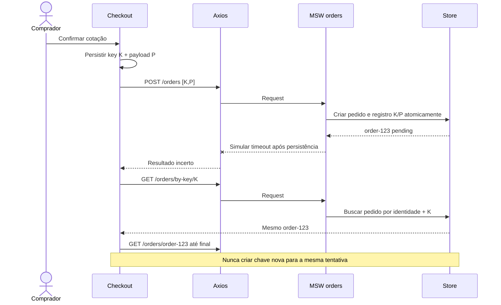

# Idempotência, concorrência e recuperação

A chave identifica **uma tentativa lógica**, não um clique. Gerá-la uma vez, persistir junto aos dados necessários de recuperação e reutilizá-la somente com o mesmo conteúdo. Desabilitar o botão durante envio ajuda na UX, mas não garante idempotência.

No repositório simulado, a criação precisa ser atômica: mesma chave e mesmo payload canônico devolvem o mesmo pedido; mesma chave com payload diferente gera conflito. Vincular a chave ao usuário, definir sua retenção e impedir que concorrência crie duplicatas. Se houver timeout após criação, consultar o pedido pela chave, sem gerar outra tentativa. Uma nova cotação ou alteração do pedido exige uma nova tentativa após resolver a anterior.

Na confirmação, reconciliar apenas os itens e quantidades comprados sem eliminar itens adicionados depois. Em múltiplas abas, garantir que a estratégia persistente e a operação de criação não produzam duplicação; documentar os limites da simulação.

[← Voltar ao índice](../README.md)

## Sequência de timeout após criação

[Máquinas de estado](maquinas-de-estado.md) · [Contratos detalhados](especificacao-de-contratos.md)
