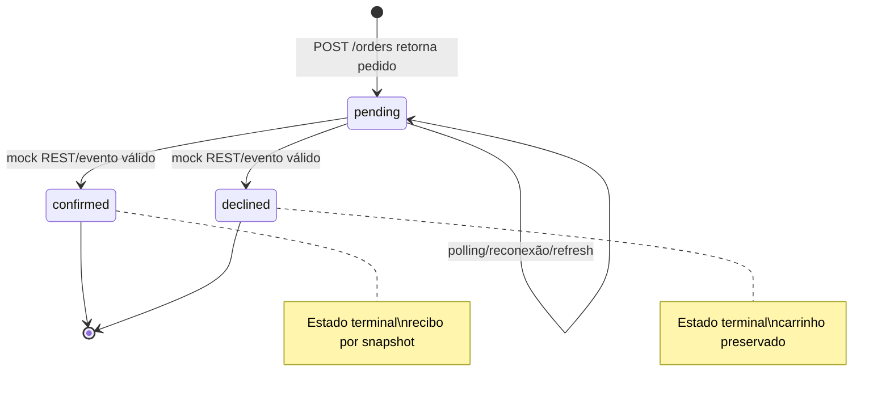
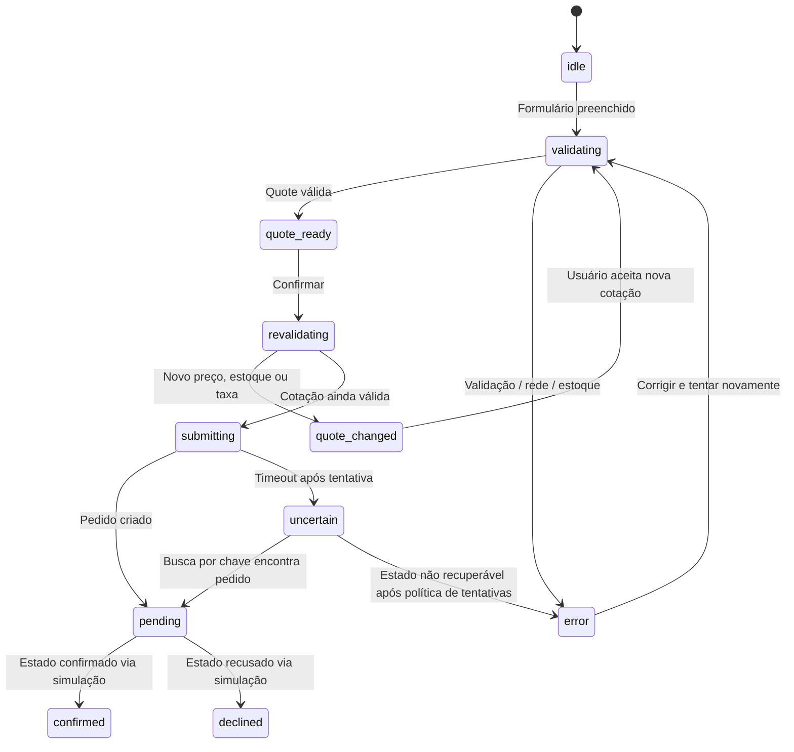
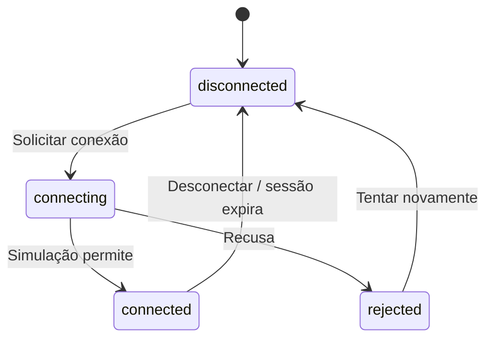

# Máquinas de estado — checkout, pedido, carteira e UI

Estados explícitos tornam o comportamento testável e impedem confirmações indevidas.

## Pedido

**Proibido:** `confirmed -> pending`, `declined -> confirmed`, “sucesso” sem resposta da simulação e novo pedido ao atualizar a página.

## Checkout

## Carteira simulada

## Estados de carregamento de feature

`idle -> loading -> success | empty | error`; ao fazer refetch em background, manter dados existentes e mostrar indicador não intrusivo. Cada estado deve ter texto/semântica/feedback acessível.

## Invariantes de implementação

- Eventos com `version` inferior/igual à observada não devem efetuar transição.
- Evento de `order.updated` com outro `userId` nunca altera pedido atual.
- O cliente pode navegar durante `pending`; estado deve ser recuperável.
- A recusa preserva carrinho; confirmação atualiza apenas quantidades efetivamente compradas.

[Idempotência](idempotencia-e-recuperacao.md) · [Índice](../README.md)
