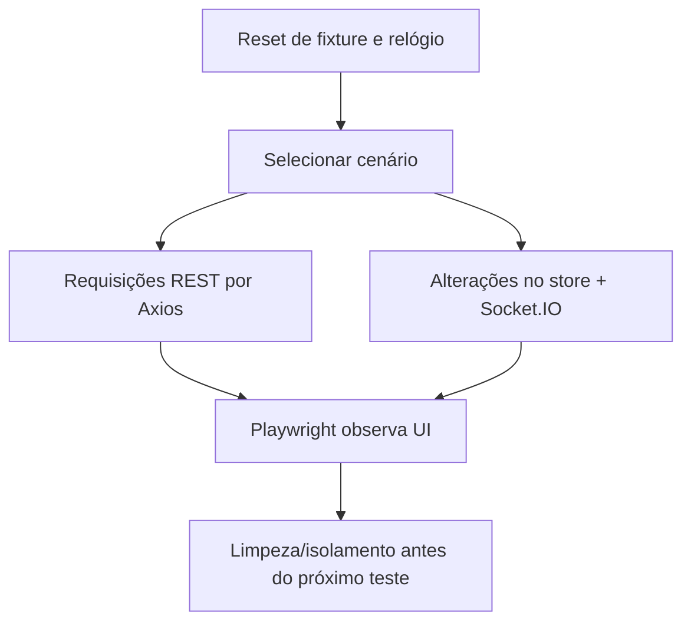

# MSW, fixtures e cenários

MSW intercepta REST e simula a comunicação em tempo real. As respostas e os eventos devem derivar do **mesmo estado persistente**. A proposta usa IndexedDB ou adaptador equivalente com versão de esquema e reset completo.

- Fixtures determinísticas: pelo menos dois usuários fictícios e variedade suficiente de NFTs, categorias, edições e estoques para filtros e paginação. A arquitetura sugere 20–30 itens, carteiras e cupons variados.
- Criar cenários reproduzíveis de sucesso, vazio, lentidão, respostas fora de ordem, offline/timeout, erros 4xx/5xx, sessão expirada, cadastro conflitante, cupom inválido/expirado, preço/estoque alterado, pagamento confirmado/recusado e timeout após criação.
- Incluir eventos antigos/duplicados e reconexão. O reset deve restaurar também estado, identidade, relógio lógico e cenário quando existirem.
- Os endpoints de controle `__test/reset`, `__test/scenario` e `__test/event` são proposta para mocks/testes. O controle de evento deve mudar o repositório e emitir pelo socket; não atualizar componentes diretamente. Delimitar e documentar sua disponibilidade no build de demonstração, sem tratá-los como endpoints de produção.
- Mocks devem ser ativáveis por configuração e estar disponíveis no build de demonstração. Documentar seleção, reset e limitações.

[← Voltar ao índice](../README.md)

## Ciclo de cenário determinístico

**Observação:** cenários de teste devem mudar o repositório antes de emitir socket, de modo que o `GET` subsequente confirme o mesmo valor.
