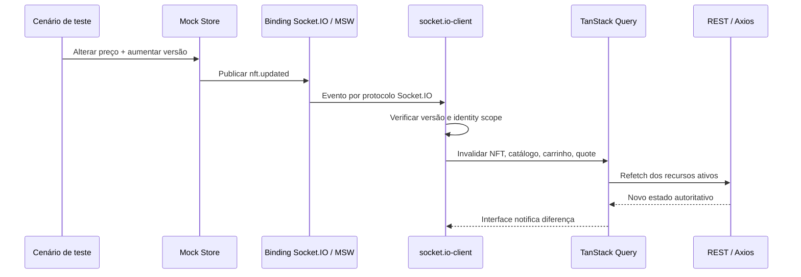

# Tempo real com Socket.IO

Eventos mínimos:

| Evento | Efeito |
|---|---|
| `nft.updated` | Atualizar ou invalidar catálogo e detalhe; avisar no carrinho, refletir disponibilidade/preço e invalidar cotação antiga |
| `order.updated` | Atualizar somente o pedido do usuário correto, com feedback de confirmação ou recusa |

Cada evento deve ter identidade estável e versão. Descartar duplicatas e versões anteriores ou iguais à já aplicada; nunca regredir pedido terminal. Eventos da sessão anterior não podem alcançar dados da conta seguinte. Liberar listeners e subscriptions.

Após reconexão ou refresh, reconsultar por REST os recursos ativos; o estado do repositório é a fonte de verdade. Testar o caso de NFT alterado enquanto está no carrinho e a desconexão de um pedido pendente.

**Risco prioritário:** a arquitetura propõe MSW + `@mswjs/socket.io-binding`, namespace padrão, mensagens textuais e `transports: ['websocket']`. Ela registra limitações para namespaces adicionais, acknowledgements e binários. Essas capacidades dependem da versão efetivamente usada: validar no começo o handshake, eventos, duplicatas, reconexão e o funcionamento no preview/build publicado. Não substituir o socket por chamada direta ao cache ou a callbacks. Registrar versão e resultado real do experimento.

[← Voltar ao índice](../README.md)

## Sequência de evento de preço

**Invariante:** sem `socket.io-client` no percurso, a simulação não satisfaz o requisito. Em reconexão, REST prevalece.
