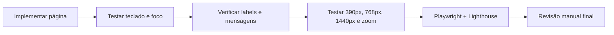

# Acessibilidade e usabilidade inclusiva

## Referências

- **Exigido pelo README:** foco visível, navegação por teclado, labels, feedback de erro/estado, semântica, alt, contraste, ausência de overflow e movimentos reduzidos.
- **Diretriz proposta:** [WCAG 2.2 AA](https://www.w3.org/WAI/standards-guidelines/wcag/); além do alvo Lighthouse Accessibility ≥ 95. A pontuação Lighthouse não comprova conformidade WCAG.

## Regras operacionais

| Área | Verificação |
|---|---|
| Navegação | Tab/Shift+Tab alcançam todos os comandos; Enter/Espaço acionam botões |
| Foco | Modal/drawer captura foco, Esc fecha quando apropriado, foco volta ao gatilho |
| Formulário | Label programático; erros ligados a campo; mensagens claras |
| Feedback | Toast ou área `aria-live` adequada sem anúncios repetidos de eventos |
| Imagens | `alt` descritivo quando informativa; `alt=""` quando decorativa |
| Cores | Contraste legível; status não comunicado apenas por cor |
| Movimento | `prefers-reduced-motion` remove shimmer/movimento excessivo |
| Zoom e viewport | 200% de zoom e 390px sem perda de conteúdo ou ações |
| Loading | Skeleton mantém geometria e tem alternativa de estado para leitores de tela |
| Links | Links têm destino real ou comunicam indisponibilidade; sem feedback enganoso |

## Sequência de verificação

## Testes essenciais

- [ ] Filtros mobile no drawer deixam foco bem administrado.
- [ ] Um formulário inválido aponta e descreve campos com erro.
- [ ] Modal de revisão de compra permite navegação e cancelamento por teclado.
- [ ] Evento de mudança de preço informa usuário sem desorientar foco.
- [ ] Animações respeitam `prefers-reduced-motion`.
- [ ] Zoom preserva carrinho, resumo e botão de confirmação.

[Design system](../04-design-system/tokens-e-componentes.md) · [RNF](../01-visao-geral/requisitos-nao-funcionais.md).
