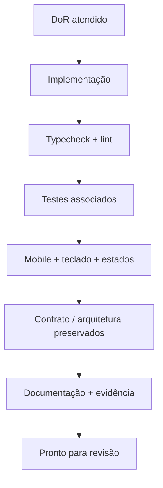

# Definition of Ready / Definition of Done

## Definition of Ready (DoR) — iniciar uma feature

- [ ] Escopo limitado e requisitos RF/RNF/RN identificados.
- [ ] Tabela/diagrama do fluxo de sucesso e falha compreendido.
- [ ] Contratos de API e eventos definidos ou marcada pendência.
- [ ] Dependências de módulos identificadas e não conflitantes com agentes paralelos.
- [ ] Critérios de aceite observáveis, com teste pretendido.
- [ ] Assets do protótipo inspecionado via MCP do Pencil acessíveis ou substituição explicitamente registrada.

## Definition of Done (DoD) — concluir uma feature

- [ ] Funcionalidade real, não protótipo visual apenas.
- [ ] REST via Axios/MSW, Socket.IO via cliente quando aplicável.
- [ ] Dados privados isolados; falhas tratadas; reenvio seguro para mutations.
- [ ] Unit/contract/component/E2E necessários passam **de fato**.
- [ ] Responsividade e foco verificados nas variações relevantes.
- [ ] Layout revisado contra o protótipo via MCP do Pencil e baseline visual quando pertinente.
- [ ] Logs, tokens e dados de teste revisados.
- [ ] Documento/ADR e TASKS atualizados com resultados reais.

## Definition of Release (DoRel)

- [ ] Todos os itens eliminatórios satisfeitos.
- [ ] URL pública estável + repositório + lockfile.
- [ ] Login, compra, pedido e Socket.IO reproduzíveis no deploy.
- [ ] E2E, regressão visual e Lighthouse com relatórios e justificativas.
- [ ] Execução a partir de checkout limpo comprovada.
- [ ] Limitações registradas com transparência (sem afirmar conclusão indevida).

[RF](../01-visao-geral/requisitos-funcionais.md) · [Gate de qualidade](../01-visao-geral/requisitos-nao-funcionais.md).
