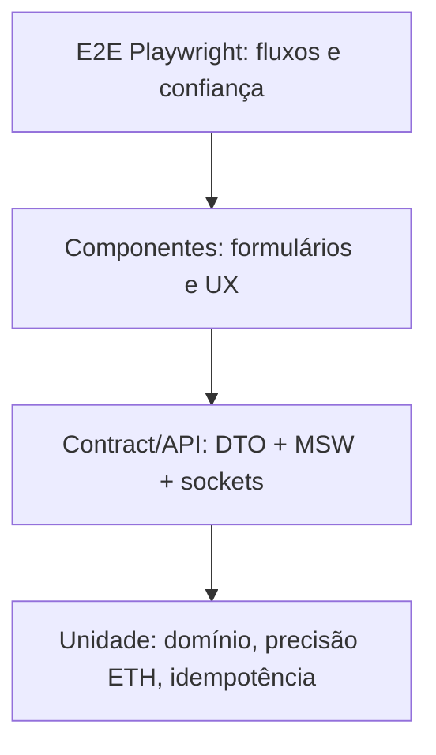

# Estratégia de testes e pirâmide de qualidade

## Níveis e objetivos



| Nível | Alvo | Exemplos | Ambiente |
|---|---|---|---|
| Unit | regras puras | decimal ETH, merge, versioning, serialização | Vitest sugerido |
| Contrato | tipos + mocks | 401/403/409, quote, order, reset, evento versionado | MSW + harness |
| Componente | UI e acessibilidade | validação, foco, erro, skeleton | Testing Library sugerido |
| E2E | jornada real | filtro→detalhe→carrinho→checkout→recibo | Playwright Chromium |
| Visual | fidelidade/estabilidade | Home, detalhe, carrinho, pagamento | Baselines Playwright |
| Auditoria | performance e qualidade | Home/detalhe mobile/desktop × 3 | Lighthouse |

## Casos Playwright obrigatórios do README

1. Busca, filtro combinado, sort, página e histórico.
2. Detalhe com acesso direto e 404.
3. Cadastro, login, sessão expirada, logout e troca de usuário.
4. Favoritos e rollback após falha.
5. Carrinho, quantidades, remoção, cupom, refresh e merge pós-login.
6. Compra completa até recibo.
7. Recusa, duplo clique, timeout e recuperação de mesmo pedido.
8. Perfil, avatar, senha e carteiras com validação.
9. Preço/disponibilidade via Socket.IO durante checkout.
10. Duplicatas/eventos antigos, desconexão e pedido pendente.
11. Teclado, diálogos e formulários.
12. Skeletons, latência, erro e retry.

## Isolamento e determinismo

- Antes de cada teste: escolher fixture, resetar store e identificadores, relógio e latência.
- Não compartilhar estado global entre workers em paralelo sem isolamento de contexto/DB; preferir cenário de teste por context/test id.
- Não adicionar `waitForTimeout` para mascarar corrida; esperar por observáveis (locators e estados).
- Instalar testes de tempo real via `socket.io-client`; não alterar diretamente cache com helper interno.
- Teste de API deve passar pelos handlers MSW e `Axios` usado pela aplicação.
- Traces e relatório HTML da falha devem ser produzidos e disponibilizados como evidência.

## Evidências versionáveis

```text
artifacts/
├── playwright-report/          # HTML do run
├── test-results/               # traces / screenshots
├── visual-baselines/           # imagens estáveis no repo
└── lighthouse/
    ├── home-mobile.{html,json}
    ├── home-desktop.{html,json}
    ├── detail-mobile.{html,json}
    └── detail-desktop.{html,json}
```

Os paths são propostos e dependem de execução; não criar relatórios fictícios.

## Coverage policy (proposta)

- Todo RF relevante para produto mapeado a pelo menos um caso observável.
- Identidade, checkout, idempotência, sessão expirada e socket devem passar por E2E.
- Metas de percentual de linhas **não** substituem testes de comportamento.

[Matriz RF↔E2E](matriz-de-testes-e-requisitos.md) · [Performance](lighthouse-e-performance.md) · [DoD](definition-of-done.md).
