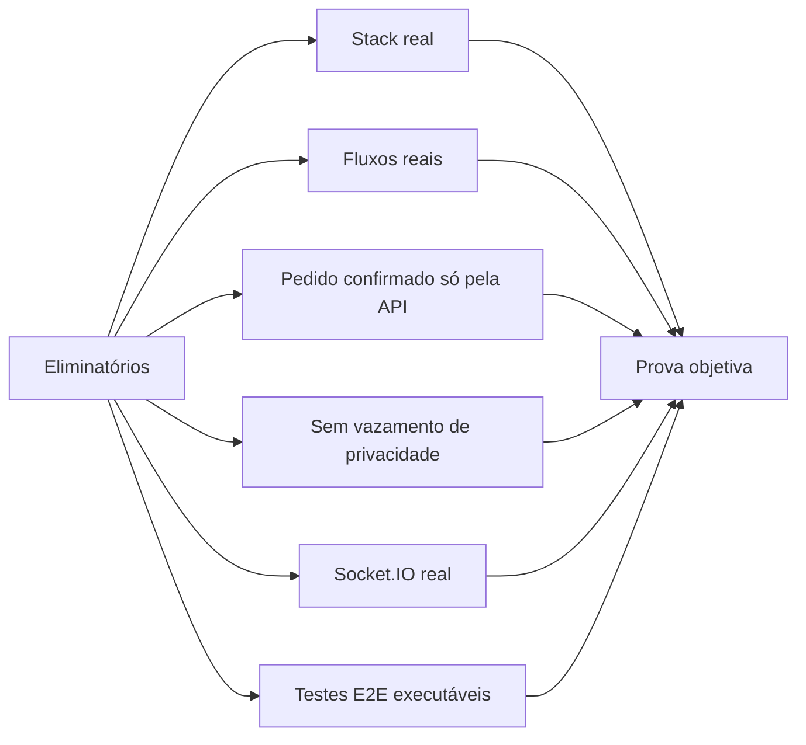

# Matriz de aceitação — requisito → cenário → evidência

As IDs são internas. Os nomes de testes e comandos abaixo são **propostos**, não testes já existentes.

| ID | Fluxo / regra | Teste Playwright planejado | Aceite objetivo |
|---|---|---|---|
| AT-01 | Filtros e busca sincronizados | `catalog.spec.ts` | URL muda, refresh/histórico preservam resultado |
| AT-02 | Requisições fora de ordem | `catalog.spec.ts` | Resposta obsoleta não substitui consulta atual |
| AT-03 | Detalhe inexistente | `catalog.spec.ts` | Acesso direto resulta em 404 adequado |
| AT-04 | Login/cadastro + erro | `auth.spec.ts` | Sessão por REST, validação e conflito de cadastro |
| AT-05 | Logout/troca usuário | `auth.spec.ts` | Nenhuma tela/cache/socket expõe dados anteriores |
| AT-06 | Favorito otimista | `favorites.spec.ts` | 5xx provoca rollback do estado visível |
| AT-07 | Carrinho visitante | `cart.spec.ts` | Refresh e login preservam itens e expõem conflitos |
| AT-08 | Cupom e valores ETH | `cart.spec.ts` + teste puro | Total coincide com API e decimal sem float incorreto |
| AT-09 | Checkout com pedido confirmado | `checkout.spec.ts` | Recibo só aparece após `confirmed` real |
| AT-10 | Pedido recusado | `checkout.spec.ts` | Carrinho intacto e status `declined` |
| AT-11 | Clique duplo e timeout | `checkout.spec.ts` | Mesma `Idempotency-Key` recupera único pedido |
| AT-12 | Cotação stale durante compra | `realtime.spec.ts` | Evento socket invalida cotação e exige novo aceite |
| AT-13 | Evento antigo/duplicado | `realtime.spec.ts` | Versão de recurso não regride |
| AT-14 | Reconexão do pedido pendente | `realtime.spec.ts` | REST reconcilia sem novo pedido |
| AT-15 | Perfil/senha/carteiras | `account.spec.ts` | Dados persistem, 4xx exibidos e dono verificado |
| AT-16 | A11y teclado/dialog/form | `accessibility.spec.ts` | Foco, labels e mensagens acessíveis |
| AT-17 | Skeleton/loading/error | `network.spec.ts` | Estado lento e recuperação visíveis |
| AT-18 | Snapshot visual | `visual.spec.ts` | Comparação em 390/1440 sob fixture estável |
| AT-19 | Lighthouse | `audits/*` | 3 medições por tela/perfil e medianas registradas |
| AT-20 | Build publicado | smoke deploy | Deep link/refresh/MSW/socket realmente operam |

## Critérios eliminatórios rastreados

## Evidências a registrar durante implementação

- Comando exato e código de saída.
- Versão de navegador/ferramenta.
- Cenário/reset de fixture aplicado.
- Relatório HTML, trace, screenshot ou captura de console.
- Limitação conhecida e criticidade.

**Não marque estes itens como verificados apenas porque os testes foram escritos.** Necessário executar em ambiente limpo e repetir no deploy quando aplicável.

[Índice principal](../README.md)
