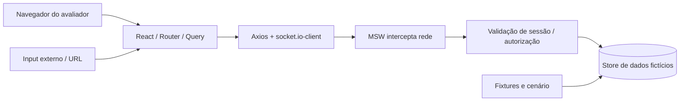

# Segurança de aplicação — threat model, controles e limites

> **Importante:** este é um **desafio simulado no navegador**, não uma arquitetura de produção com controles de infraestrutura. O objetivo é modelar acesso correto e não criar falhas de segurança óbvias. O cumprimento de normas reais não pode ser afirmado sem auditoria.

## Referências de engenharia

- [OWASP ASVS 5.0.0](https://asvs.owasp.org/) — catálogo de requisitos de segurança de aplicações (referência, não certificação).
- [OWASP Session Management](https://cheatsheetseries.owasp.org/cheatsheets/Session_Management_Cheat_Sheet.html) e [Authentication](https://cheatsheetseries.owasp.org/cheatsheets/Authentication_Cheat_Sheet.html) — práticas para aplicações reais; adaptar para simulação.

## Fronteiras de confiança

**Limite essencial:** qualquer pessoa pode inspecionar código e dados locais; a simulação não garante segredo de uma sessão como um backend real. A proteção objetiva é **não vazar dados entre fluxos/contas pela interface e mock API**.

## Análise de ameaças (STRIDE adaptado)

| Classe | Ameaça no desafio | Controle | Prova |
|---|---|---|---|
| Spoofing | `userId` forjado em request | API extrai identidade da sessão | E2E ID de conta alheia |
| Tampering | `quantity`, preço ou quote alterada no browser | API revalida e bloqueia 409/422 | Teste de compra stale |
| Repudiation | Clique repetido vira dois pedidos | Idempotency-Key + hash do payload | E2E timeout/double click |
| Information disclosure | Query/cache/evento de A aparece para B | sessionEpoch, cleanup e owner checks | E2E A→logout→B |
| Denial of service | Requests repetidos ou falha de rede geram loop | retries limitados, abort/cancel | E2E 5xx/offline |
| Elevation of privilege | Acesso direto a pedidos privados | autorização no MSW, não apenas Router | E2E 403/404 |

## Controles obrigatórios de implementação

1. **Autorização:** server-like handlers consultam sessão, nunca aceitam `userId` do body como dono.
2. **Validação:** Zod/DTO na entrada de API, search params e formulários; rejeitar tipo/quantidade/identificador fora do contrato.
3. **Sessão:** criar IDs imprevisíveis *fictícios*; TTL configurável; logout invalida sessão; respostas 401 derrubam o identity scope.
4. **Cache:** chaves com dono e limpeza completa ao trocar conta; ignore de respostas antigas via epoch/abort.
5. **Eventos:** assinatura por escopo de sessão; versões monotônicas; listener cleanup; descartar evento de sessão anterior.
6. **Compra:** quote autoritativa e idempotência transacional; nenhuma confirmação otimista de pagamento.
7. **XSS e links:** não usar HTML cru não sanitizado, validar `redirect` local, `rel="noopener noreferrer"` em links externos quando necessário.
8. **Dados de demonstração:** nomes, e-mails, endereços, senhas e carteiras fictícios, sem dados reais.
9. **Segredos:** nunca commitar `.env` contendo credenciais reais, tokens, chaves privadas ou segredos de deploy.
10. **Supply chain:** lockfile e auditoria de dependências; exceções justificadas e registradas.

## Ações proibidas por padrão

- Conectar carteira Ethereum verdadeira, pedir seed phrase ou executar transação real.
- Registrar senha ou bearer token no console e no trace.
- Usar `localStorage` como alegação de segurança de produção.
- Desproteger o backend real só porque o frontend restringe um botão.
- Criar endpoint de teste visível como funcionalidade normal do produto em produção.

## Lista de testes de segurança

- [ ] User A → logout → User B nunca mostra favoritos, perfil, carteiras ou pedido de A.
- [ ] `GET /orders/:orderId` de outro titular retorna 403 ou 404 sem payload privado.
- [ ] `POST /orders` com total editado ou quote velha não confirma compra.
- [ ] Mesmo header de idempotência + payload diferente retorna conflito.
- [ ] Redirect externo é recusado e rota local segura é mantida.
- [ ] Senha/chave fictícia não aparecem em traces/logs.

[Permissões](../01-visao-geral/atores-e-permissoes.md) · [Autenticação](../05-integracoes/autenticacao-e-sessao.md) · [Casos E2E](matriz-de-testes-e-requisitos.md).
