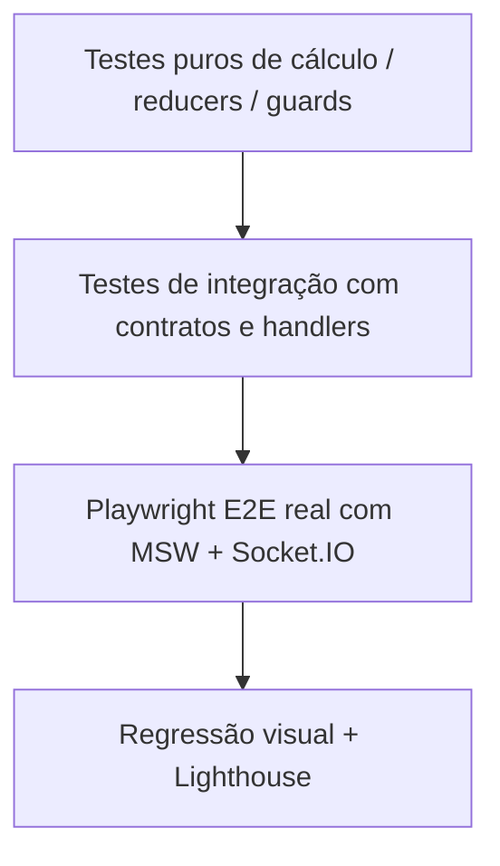

# Estratégia de testes

Os testes precisam operar a interface e atravessar as camadas reais de rede simulada: REST pelos handlers MSW e tempo real pelo `socket.io-client`. Cada teste começa em estado isolado. Controlar relógio, dados, latência e eventos sensíveis ao tempo.

| Área | Cobertura mínima E2E |
|---|---|
| Catálogo | Busca, filtros combinados, ordenação, paginação, histórico e refresh |
| Detalhe | Acesso direto, inexistente, edição indisponível e quantidade |
| Autenticação | Cadastro, login, expiração, logout e troca de usuários |
| Favoritos | Inclusão/remoção, falha e rollback |
| Carrinho | Quantidades, remoção, cupom, refresh e união após login |
| Pedido | Compra completa e recibo, recusa, cliques repetidos e timeout recuperado |
| Conta | Perfil, avatar, senha, carteiras e validações |
| Tempo real | Preço/estoque, cotação antiga, duplicatas, ordem, desconexão e recuperação |
| Acessibilidade | Teclado, foco em diálogos e erros de formulário |
| Rede | Skeleton em lentidão, erro e tentativa de recuperação |

Executar fluxos principais em Chromium desktop e mobile. Versionar baselines visuais de início, detalhe, carrinho e pagamento com dados e ambiente estáveis; gerar relatório HTML e traces de falhas. Testes unitários de cálculos, ordenação de eventos e regras puras são uma sugestão complementar, não substituem o E2E obrigatório.

[← Voltar ao índice](../README.md)

## Pirâmide de confiança

Os testes puros são complemento opcional; **E2E executáveis são obrigatórios**. Consulte a [matriz de aceitação](matriz-de-aceitacao.md).
