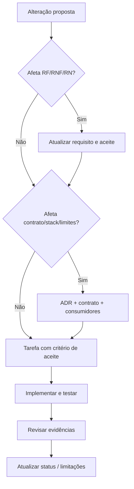

# Governança de mudanças e controle de arquitetura

## Fluxo de proposta de alteração



## Política para agentes paralelos

- Só um agente altera contratos compartilhados, configurações-base e tipos do domínio por vez.
- Outros agentes dependem de snapshots/contratos estáveis; evitam editar os mesmos arquivos.
- Alteração em campo/evento/schema requer atualizar mocks, consumidores, fixtures e testes juntos.
- Agente responsável por UI não pode simular backend em local state para “avançar”.
- Teste que falha não deve ser removido ou alterado sem justificativa funcional.

## Modelo de registro de mudança

```text
CHANGE-ID:
Motivo:
Requisito/ADR impactado:
Arquivos e módulos impactados:
Alternativas consideradas:
Impacto em contrato, dados, segurança e UX:
Critério de aceite atualizado:
Testes/evidências reais:
Risco residual:
```

## Controle de escopo

Não criar backend PostgreSQL, blockchain real, páginas extras ou camadas sofisticadas antes dos critérios eliminatórios estarem implementados e verificados.

[Contrato da documentação](../00-comecar/contrato-da-documentacao.md) · [TASKS](../TASKS.md).
