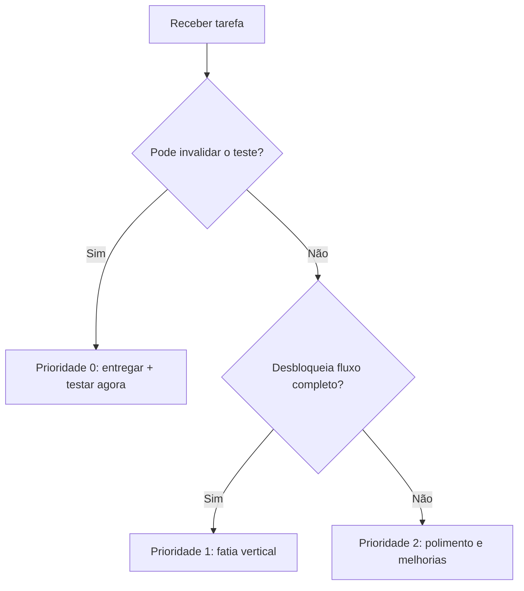

# Riscos técnicos, impacto e planos de contingência

| Risco | Impacto | Prevenção | Sinal de falha / resposta |
|---|---|---|---|
| `socket.io-client` + binding MSW incompatíveis | **Crítico** (eliminatório) | Prova de conceito antes das telas | Não passar handshake → ajustar transporte/versões mantendo protocolo e documentar |
| MSW não inicializa no deploy | **Crítico** | Smoke test no build de preview e hospedagem | HTTP real não interceptado → corrigir worker path/escopo |
| Fluxo apenas visual | **Crítico** | Fatias verticais com aceite E2E | Botão não chama API → não marcar feature como pronta |
| Vazamento entre usuários | **Crítico** | Query keys por identidade + teardown | Dados A em B → bloquear entrega até corrigir |
| Pedido duplicado | **Crítico** | Persistir chave, hash e lookup no mock store | Timeout gera novo pedido → consertar antes de polir UI |
| Protótipo no Pencil/assets incompletos | Alto (fidelidade) | Inventariar frames cedo | Divergência → registrar e priorizar telas avaliadas |
| Paralelismo de agentes conflita | Alto | Contratos com ownership e PRs/tarefas separadas | Type errors ao integrar → congelar contratos e resolver diferenças |
| Dependência de Docker/Postgres | Alto (deploy) | Evitar como requisito do caminho crítico | Build online requer backend → retirar dependência |
| Playwright não determinístico | Alto | Reset, relógio, latência e event triggers | Flaky tests → isolar estado e relógio |
| Lighthouse abaixo das metas | Médio/alto | Assets locais otimizados, CLS e lazy loading | Reportar honestamente resultados e causas |
| Prazo reduzido | Alto | Testar stack e fluxos eliminatórios cedo | Repriorizar transparência sobre mock visual |

## Matriz de priorização

**Estratégia recomendada:** integrar e testar continuamente, não criar uma fase de “UI inteira” separada de uma fase de “funcionalidades”.

[Índice principal](../README.md)
