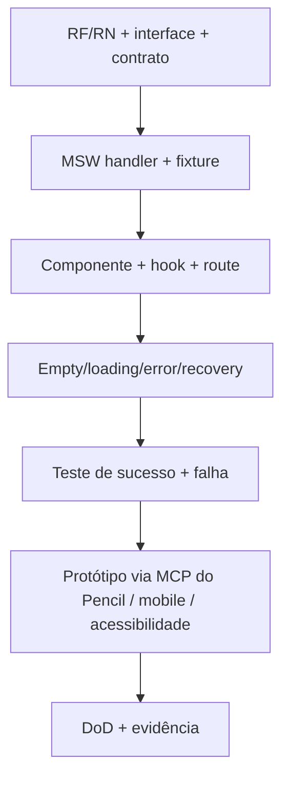

# Roadmap de implementação por fatias verticais

> O prazo da candidatura é curto; os períodos abaixo são **sequência de dependência**, não garantia de conclusão. Sempre tratar documentação, UI, mock e teste da mesma feature.

| Milestone | Entrega vertical | RF principais | Critério de saída |
|---|---|---|---|
| M0 | bootstrap, rotas, MSW REST, socket POC, deploy mínimo | 057–059 | smoke build/deploy e REST/socket provados |
| M1 | catálogo, detalhe, URL, estados de erro | 001–011 | busca+filter+history e 404 via E2E |
| M2 | conta, sessão, favoritos, perfil base | 012–023 | login/logout/A-B isolado e rollback favorito |
| M3 | carrinho, merge, cupom e quote | 024–035 | refresh/merge + carrinho e totais consistentes |
| M4 | pedido, wallet, eventos, reconexão | 036–049 | single-order, snapshot, socket e recuperação |
| M5 | refinamento das nove telas, visual, acesso e release | 050–059 | suíte E2E, Lighthouse e deploy público |

## Ciclo por feature

## Ordem de priorização

1. **Eliminatórios:** stack real, todos fluxos funcionalmente reais, pagamento vindo de API, isolamento, Socket.IO real e Playwright.
2. **Fluxos centrais:** catálogo → item → carrinho → quote → pedido.
3. **Conta:** auth/logout, recuperação e carteira.
4. **Qualidade incremental:** componentes compartilhados, acessibilidade, regressão visual, auditoria.

**Importante:** o README exige todas as telas e os cenários, portanto priorizar não significa omitir silenciosamente itens.

[DoD](../06-qualidade/definition-of-done.md) · [TASKS](../TASKS.md).
