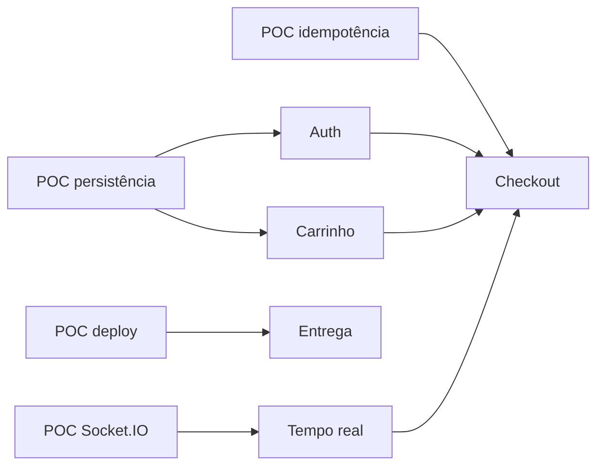

# Spikes técnicos prioritários e caminhos críticos

> **Spike:** experimento curto que reduz incerteza; não substitui feature pronta. Todos começam **PENDENTES** até haver evidências.

## POC-01 — MSW e Socket.IO (crítico)

**Pergunta:** MSW + binding interoperam com a versão de `socket.io-client` escolhida no browser, inclusive no deploy estático?

**Procedimento:** iniciar worker → conectar socket com namespace padrão → enviar evento `nft.updated` por mock → cliente recebe via protocolo → invalidar query e refetch REST → desconectar/reconectar → confirmar versão correta.

**Aceite:** observável no browser e teste, sem setters/shortcuts. **Bloqueia:** eventos, checkout. **Risco:** binding só texto/default namespace.

## POC-02 — Persistência e reset de fixtures

**Pergunta:** store consistente persiste após refresh e restaura seed determinístico em Playwright?

**Procedimento:** criar usuário A e carrinho → refresh → dados persistem → reset → fixture original → iniciar B e confirmar isolamento.

**Aceite:** nenhuma mistura de usuários nem de cenários. **Bloqueia:** auth, carrinho e pedidos.

## POC-03 — Deploy estático e roteamento

**Pergunta:** rotas do TanStack Router reabrem após refresh, com worker MSW e sockets habilitados?

**Procedimento:** publicar build mínimo → abrir `/nft/nft-001` diretamente → refresh → chamada REST interceptada → websocket funcional.

**Aceite:** demonstrável em URL pública sem backend privado. **Bloqueia:** entrega final.

## POC-04 — Cotação/idempotência

**Pergunta:** dois POST concorrentes com mesma chave e timeout pós-commit retornam o mesmo pedido?

**Procedimento:** criar carrinho → quote → dois POST mesmos dados/key → interromper resposta → GET por chave → contar registros.

**Aceite:** exatamente um pedido por tentativa, conflito para key com payload divergente.

[Marcos](marcos-de-implementacao.md) · [Riscos](riscos-e-contingencias.md).
