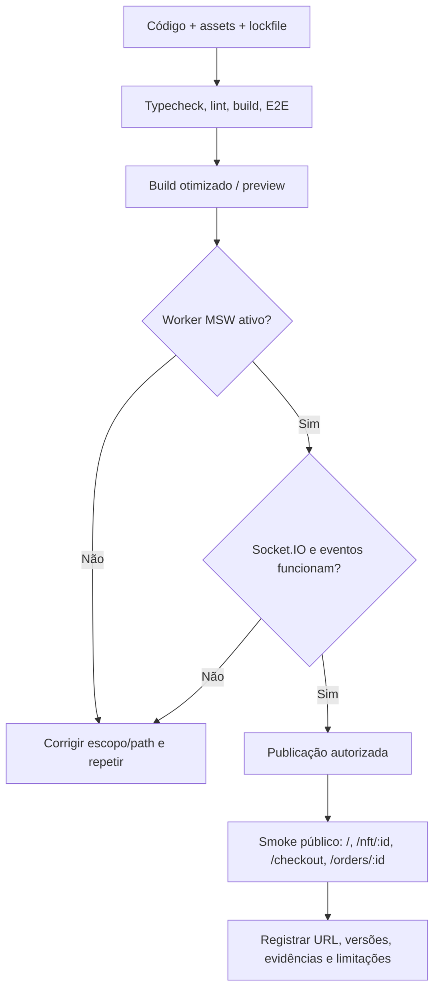

# Deploy e validação da demonstração pública

**[EXIGIDO]** URL pública + repositório; aplicação publicada precisa corresponder ao código, funcionar sem serviços privados e suportar deep links/refresh, MSW e Socket.IO simulados.

## Fluxo de publicação proposto

## Checklist pós-deploy

- [ ] `GET /api/nfts` interceptado por MSW no domínio público.
- [ ] `socket.io-client` conecta por protocolo compatível e recebe `nft.updated` e `order.updated`.
- [ ] Refresh diretamente em `/nft/nft-001`, `/login`, `/checkout` e pedido funciona (rewrite SPA).
- [ ] Login, sessão e carrinho preservam comportamento após refresh.
- [ ] Checkout com confirmação/recusa/timeout é reproduzível.
- [ ] Fontes e imagens carregam sem links privados ou dependências do editor.
- [ ] Metas Lighthouse auditadas honestamente com build real e mocks completos.
- [ ] E2E não depende de banco privado/PostgreSQL local.
- [ ] Arquivos `README.md`, `ARCHITECTURE.md`, relatórios e versões atualizados.

## Hospedagem

Vercel, Netlify ou Cloudflare Pages são opções aceitas no desafio. Para uma SPA, configurar rewrite/fallback para `index.html` (respeitando assets estáticos e o worker). A configuração exata deve seguir a plataforma escolhida e ser verificada após deploy.

**Não publicar nem enviar a candidatura sem autorização explícita** quando um agente estiver operando o repositório do usuário.

[Índice principal](../README.md)
