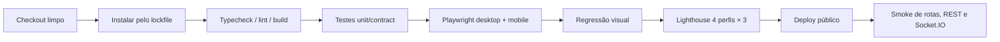

# Guia de verificação, evidências e entrega

## Pipeline a implementar (proposto)



## Verificações de release

| Verificação | Evidência esperada | Status inicial |
|---|---|---|
| Clean install e build | logs + lockfile | Não executado |
| TS strict e lint | logs de scripts | Não executado |
| 12 grupos E2E | relatório Playwright + traces | Não executado |
| Mobile/desktop | resultados Chromium nos dois viewports | Não executado |
| Baselines | Home, detalhe, carrinho, pagamento | Não executado |
| Lighthouse | 4 perfis × 3, mediana + LCP/CLS/TBT | Não executado |
| Deploy | URL pública + repositório | Não executado |
| Refresh de rota profunda | teste direto por URL | Não executado |
| MSW em build | request HTTP interceptada | Não executado |
| Socket.IO em deploy | atualização recebida pelo client | Não executado |
| Isolamento A/B | teste E2E e logs | Não executado |

## Conteúdo mínimo de entrega

- Repositório fonte, lockfile, assets, fixtures, mocks e testes.
- `README.md` operacional com versões, instalação, credenciais fictícias, env vars, reset e cenários de falha.
- `ARCHITECTURE.md` com decisões/limitações, contratos REST e eventos, sessão, cache, merge e reconciliação.
- HTML de testes e traces das falhas; baselines visuais; HTML/JSON Lighthouse por execução.
- Deploy público alinhado ao código entregue, sem backend privado.

## Modelo de registro de execução

```text
Commit:
Data/ambiente:
Node/npm/pnpm e versões relevantes:
Comando executado:
Fixture/cenário:
Resultado observado (sucesso/falha):
Arquivo de evidência:
Falha conhecida e hipótese:
```

O README exige três medições por página e perfil. Não registrar só a maior nota: publicar a **mediana real** e explicar notas abaixo da meta.

[Checklist existente](checklist-final.md) · [Estratégia de testes](../06-qualidade/estrategia-de-testes.md).
